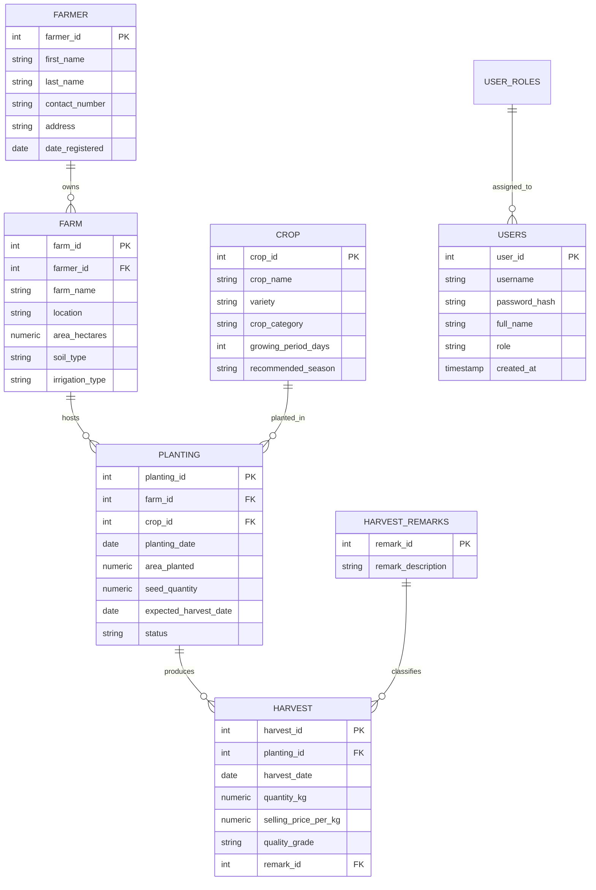

# 🌾 Agriculture Information System (AIS)
### Web Application Development (AP 3) — Midterm & Final Laboratory Project

[](https://www.php.net/)
[](https://tailwindcss.com/)
[](https://supabase.com/)
[](https://opensource.org/licenses/MIT)

---

## 📌 Project Overview

The **Agriculture Information System (AIS)** is a comprehensive, web-based database management application developed for **AP 3 (Web Application Development)**. It provides agricultural officers, farm managers, and administrative staff with centralized tools to manage farmers, farms, crop varieties, planting cycles, and harvest outputs.

The system is powered by a normalized **Supabase PostgreSQL** cloud database, built using modern **PHP (PDO)** with clean Object-Oriented Programming (OOP) classes, and styled with responsive, utility-first **Tailwind CSS**.

---

## 🚀 Core Features & Modules

### 1. 👨‍🌾 Farmer Management
- Full CRUD (Create, Read, Update, Delete) operations for registered farmers.
- Stores personal details: First Name, Last Name, Contact Number, Address, and Registration Date.
- Search by farmer name and filter by location/address.

### 2. 🏡 Farm Management
- Records farm profile: Farm Name, Location, Area in Hectares, Soil Type, and Irrigation Type.
- Foreign key relationship linking each farm to its registered owner (`farmer_id`).
- Referential integrity check to prevent orphan farm records.

### 3. 🌽 Crop Catalog
- Categorizes agricultural crops: Crop Name, Variety, Category (Cereal, Legume, Root Crop, Fruit, Vegetable).
- Standard growing period in days and recommended planting seasons (Dry Season, Wet Season, Year Round).

### 4. 🚜 Planting Records
- Tracks field plantings: Planting Date, Area Planted (ha), Seed Quantity (kg), Expected Harvest Date, and Status (`Planted`, `Growing`, `Harvested`).
- Multi-table `JOIN` displaying related Farm and Crop names instead of raw IDs.
- Date validation: Ensures expected harvest date falls logically after planting date.

### 5. 🧺 Harvest Records & Lookup Tables
- Records crop yields: Harvest Date, Quantity Harvested (kg), Selling Price per kg, Quality Grade (`Grade A`, `Grade B`, `Grade C`).
- **Controlled Dropdowns:** Integrated with a normalized lookup table (`harvest_remarks`):
  - `1` = Good Harvest
  - `2` = Acceptable Quality
  - `3` = Low Yield
  - `4` = Poor Quality
  - `5` = Damaged Harvest
- Dynamic revenue estimation: `Total Value = Quantity (kg) × Selling Price per kg`.

### 6. 📊 Interactive Dashboard
- Summary statistics cards:
  - 👥 Total Farmers
  - 🚜 Total Active Farms
  - 🌽 Cataloged Crops
  - 🌱 Active Plantings
  - 🌾 Total Harvests
- Recent planting and harvesting activity feeds.
- Visual status breakdown badge indicators.

### 7. 📈 Reports Engine
- Filterable agricultural reports:
  - **Farmers & Farm Ownership Report**
  - **Crop Production per Farm**
  - **Planting Cycle Status Report**
  - **Harvest Yield & Revenue Report** (with date range filtering)

### 8. 🔐 Authentication & Access Control
- Secure session-based authentication with password hashing (`password_hash` / `password_verify`).
- Role-Based Access Control (RBAC):
  - **👑 Administrator:** Full CRUD access, user management, and system configuration.
  - **📋 Staff:** Data entry, record viewing, updating, and report generation.

---

## 🗄️ Database Normalization Process

To eliminate data redundancy and ensure referential integrity, the database schema follows a strict normalization pathway up to **Third Normal Form (3NF)**:

```
[ Unnormalized Form (UNF) ]
          │  Remove repeating groups, ensure atomic fields, define Primary Keys
          ▼
[ First Normal Form (1NF) ]
          │  Remove partial functional dependencies (Composite Key separation)
          ▼
[ Second Normal Form (2NF) ]
          │  Remove transitive functional dependencies (Separate non-key entities)
          ▼
[ Third Normal Form (3NF) ]
```

### 1. Unnormalized Form (UNF)
A flat spreadsheet containing repeating groups:  
`Farmer_Details, Farm_Details, Crop_Details, Planting_Details, Harvest_Details` all in one table.

### 2. First Normal Form (1NF)
- All attributes contain atomic (indivisible) values.
- Repeating groups eliminated by separating main entities with Primary Keys (`farmer_id`, `farm_id`, `crop_id`, `planting_id`, `harvest_id`).

### 3. Second Normal Form (2NF)
- Satisfies 1NF.
- Removes partial dependencies: All non-key attributes are fully functionally dependent on their table's primary key.
- Separated `crop` and `farm` profiles from transaction logs.

### 4. Third Normal Form (3NF)
- Satisfies 2NF.
- Removes transitive dependencies: Non-key attributes depend **only** on the primary key.
- Harvest remarks separated into a normalized lookup table (`harvest_remarks`), storing `remark_id` in `harvest` instead of free-text strings.

---

## 📐 Entity-Relationship Diagram (ERD)



---

## 📂 Project Architecture

Structured following clean OOP and modular PHP practices taught in class:

```text
php-project-agriculture/
├── config/
│   └── Database.php             # Supabase PDO Database Connection
├── models/
│   ├── Farmer.php               # Farmer OOP Model
│   ├── Farm.php                 # Farm OOP Model
│   ├── Crop.php                 # Crop OOP Model
│   ├── Planting.php             # Planting OOP Model
│   ├── Harvest.php              # Harvest OOP Model
│   └── User.php                 # Authentication & User Model
├── views/
│   ├── layout/
│   │   ├── header.php           # Navigation Bar & Tailwind CDN setup
│   │   ├── footer.php           # Common scripts & footer
│   │   └── sidebar.php          # Responsive Navigation Sidebar
│   ├── farmers/                 # CRUD views for Farmers
│   ├── farms/                   # CRUD views for Farms
│   ├── crops/                   # CRUD views for Crops
│   ├── plantings/               # CRUD views for Planting operations
│   ├── harvests/                # CRUD views for Harvest records
│   └── reports/                 # Printable Report Tables
├── auth/
│   ├── login.php                # Authentication page
│   └── logout.php               # Session termination
├── docs/
│   ├── ap3-project.docx         # Official University Project Specification
│   ├── ERD.png                  # Entity Relationship Diagram
│   └── normalization.md         # Detailed 1NF, 2NF, 3NF documentation
├── index.php                    # Main Dashboard Entrypoint
├── README.md                    # System Documentation
└── .gitignore                   # Ignore sensitive environment files
```

---

## 🛠️ Technology Stack

| Component | Technology | Description |
| :--- | :--- | :--- |
| **Language** | PHP 8.1+ | Server-side logic with PDO (PHP Data Objects) |
| **Database** | PostgreSQL / Supabase | Cloud-hosted relational database engine |
| **Styling** | Tailwind CSS | Modern, utility-first CSS framework |
| **Icons** | Heroicons / SVG | Crisp, modern UI icons |
| **Architecture**| Modular OOP | Clean separation between Database, Models, and Views |

---

## ⚙️ Installation & Setup

### 1. Clone the Repository
```bash
git clone https://github.com/villariasa/php-project-agriculture.git
cd php-project-agriculture
```

### 2. Configure Database Connection
Update `config/Database.php` with your **Supabase PostgreSQL** credentials:
```php
private string $host     = "db.YOUR_SUPABASE_PROJECT.supabase.co";
private string $port     = "5432";
private string $dbname   = "postgres";
private string $username = "postgres";
private string $password = "YOUR_SUPABASE_DB_PASSWORD";
```

### 3. Run Local Development Server
```bash
php -S localhost:8000
```
Open your browser and navigate to `http://localhost:8000`.

---

## 👤 Author & Academic Information

- **Student Developer:** Medy Villarias (`villariasa`)
- **Institution:** Cebu Technological University (CTU) — Cebu City Campus
- **Course & Code:** AP 3 — Web Application Development
- **Project:** Agriculture Information System (AIS)

---

## 📄 License
This project is open-source under the [MIT License](LICENSE).
