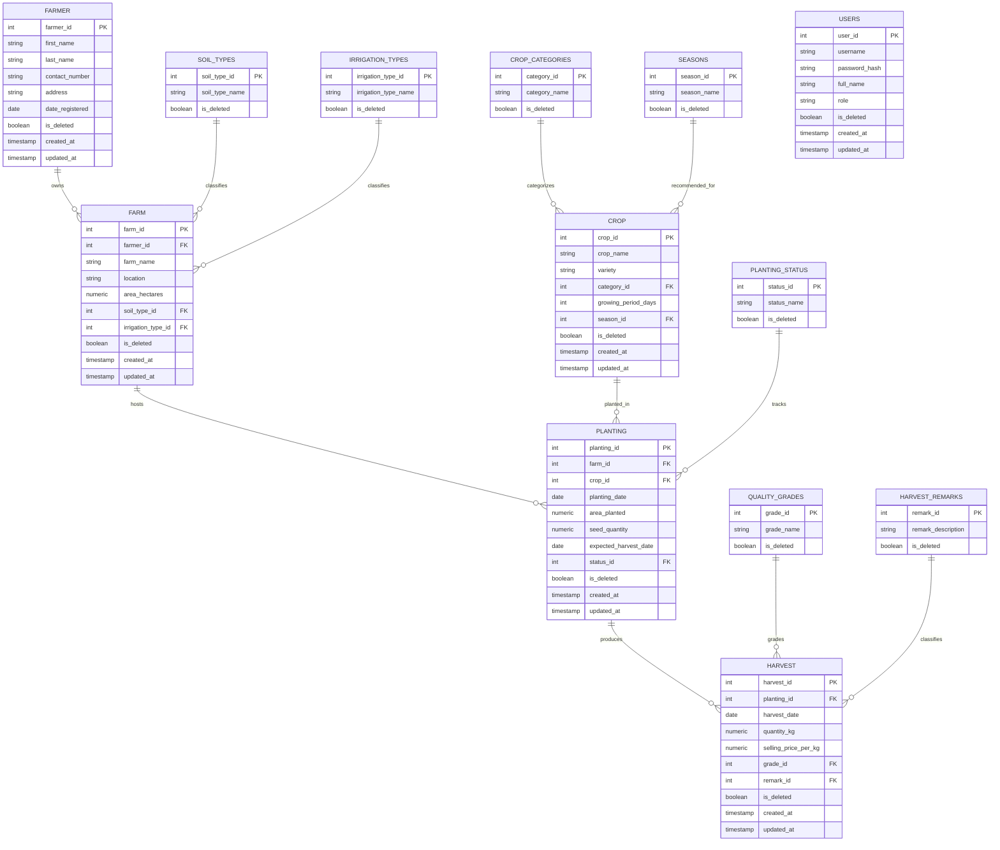

#  Agriculture Information System (AIS)
### Web Application Development (AP 3) — Midterm & Final Laboratory Project

[](https://www.php.net/)
[](https://tailwindcss.com/)
[-0ea5e9?style=for-the-badge&logo=tailwind-css&logoColor=white)](https://heroicons.com/)
[](https://supabase.com/)
[](https://opensource.org/licenses/MIT)

---

##  Project Overview

The **Agriculture Information System (AIS)** is a web-based database management application developed for **AP 3 (Web Application Development)**. It provides agricultural officers, farm managers, and administrative staff with centralized tools to manage farmers, farms, crop varieties, planting cycles, and harvest outputs.

The system runs on a fully normalized (3NF) **PostgreSQL** database — **13 tables** (6 core entities + 7 lookup tables) — hosted locally or on **Supabase**, built with modular native **PHP (PDO)** OOP classes, and styled with a clean white-theme **Tailwind CSS** UI using **Heroicons**.

### Key Design Principles
- **Full 3NF normalization** — every predefined-value field lives in its own lookup table.
- **Soft delete system-wide** — records are never physically removed; an `is_deleted` flag hides them while preserving history and referential integrity.
- **DB-driven dropdowns** — no hardcoded `<select>` options anywhere; all managed in a Settings module.
- **Audit trail** — `created_at` / `updated_at` timestamps on all core entities.

---

##  Core Features & Modules

###  1. Farmer Management
- Full CRUD (soft delete) for registered farmers.
- Personal details: First Name, Last Name, Contact Number, Address, Registration Date.
- Search by farmer name or address.
- Deletion blocked while the farmer still owns active farms.

###  2. Farm Management
- Farm profile: Name, Location, Area (ha), Soil Type, Irrigation Type.
- Owner (`farmer_id`), Soil Type, and Irrigation Type selected from **database-driven dropdowns**.
- Lists display owner and lookup names via JOINs — never raw IDs.

###  3. Crop Catalog
- Crop Name, Variety, Category, Growing Period (days), Recommended Season.
- Category and Season are lookup-table dropdowns (`crop_categories`, `seasons`).

###  4. Planting Records
- Planting Date, Area Planted (ha), Seed Quantity (kg), Expected Harvest Date, Status.
- Status comes from the `planting_status` lookup (Planted / Growing / Harvested) with filterable list.
- Multi-table JOIN displays Farm, Crop, and Farmer names.
- Date validation: expected harvest date must fall after the planting date (app + DB CHECK constraint).

###  5. Harvest Records
- Harvest Date, Quantity (kg), Selling Price per kg, Quality Grade, Remark.
- Quality Grade (`quality_grades`) and Remark (`harvest_remarks`) are lookup dropdowns — the UI shows the description, the database stores the integer ID.
- Dynamic revenue: `Total Value = Quantity (kg) × Selling Price per kg`.
- Recording a harvest automatically marks the related planting as **Harvested**.

###  6. Settings (Lookup Table Management) — *Admin only*
- One place to manage all 7 lookup tables: Soil Types, Irrigation Types, Crop Categories, Seasons, Planting Status, Quality Grades, Harvest Remarks.
- Add, rename, and soft-delete dropdown values.
- Values in use by active records **cannot** be deleted; soft-deleted values disappear from dropdowns but remain joinable for historical records.

###  7. Interactive Dashboard
- Summary cards: Total Farmers, Active Farms, Cataloged Crops, Active Plantings, Total Harvests.
- Recent planting and harvest activity feeds with status badges and revenue.
- All values query the live database (active records only) — nothing hard-coded.

###  8. Reports Engine
- **Farmers & Farm Ownership** — farm count and total hectares per farmer.
- **Crop Production per Farm** — harvested totals, filterable by farm.
- **Planting Cycle Status** — filterable by status.
- **Harvest Yield & Revenue** — date-range filter with SUM totals row.
- Every report is printable (print-friendly layout, navigation hidden).

###  9. Authentication & Access Control
- Session-based login with `password_hash` / `password_verify` (bcrypt).
- Role-Based Access Control:
  - **Administrator** — full CRUD, record deletion, and Settings (lookup management).
  - **Staff** — data entry, viewing, updating, and reports (no deletes, no Settings).
- Role checks enforced **server-side** on every delete endpoint and the Settings module.

###  10. Data Integrity & Safety
- **Soft delete everywhere** — no `DELETE` statement exists in the codebase; deleting sets `is_deleted = TRUE`.
- Styled confirmation **modal** before every deletion (spec: Confirmation Before Deletion).
- Referential integrity: deletion is blocked while active child records exist (farmer→farms, farm→plantings, crop→plantings, planting→harvests, lookup→records using it) with a friendly message.
- Prepared statements on all queries; `htmlspecialchars()` on all output.

---

##  Database Normalization (UNF → 3NF, 13 Tables)

```
[ Unnormalized Form (UNF) ]
          │  Remove repeating groups, ensure atomic fields, define Primary Keys
          ▼
[ First Normal Form (1NF) ]
          │  Remove partial functional dependencies (Composite Key separation)
          ▼
[ Second Normal Form (2NF) ]
          │  Remove transitive functional dependencies (Separate non-key entities
          │  and ALL predefined-value fields into lookup tables)
          ▼
[ Third Normal Form (3NF) ]  →  6 core entities + 7 lookup tables = 13 tables
```

### 1. Unnormalized Form (UNF)
A flat spreadsheet containing repeating groups: `Farmer_Details, Farm_Details, Crop_Details, Planting_Details, Harvest_Details` all in one table.

### 2. First Normal Form (1NF)
- All attributes atomic; repeating groups split into entities with primary keys (`farmer_id`, `farm_id`, `crop_id`, `planting_id`, `harvest_id`).

### 3. Second Normal Form (2NF)
- All non-key attributes fully functionally dependent on their table's primary key.
- `crop` and `farm` master data separated from `planting` / `harvest` transaction logs.

### 4. Third Normal Form (3NF)
- All transitive dependencies removed: every predefined-value description depends on its own lookup key, not on the transaction row. Each becomes a reference table storing an integer FK in the parent:

| # | Lookup Table | Referenced By | Replaces |
|---|--------------|---------------|----------|
| 1 | `soil_types` | `farm.soil_type_id` | free-text soil type |
| 2 | `irrigation_types` | `farm.irrigation_type_id` | free-text irrigation type |
| 3 | `crop_categories` | `crop.category_id` | free-text category |
| 4 | `seasons` | `crop.season_id` | free-text season |
| 5 | `planting_status` | `planting.status_id` | free-text status |
| 6 | `quality_grades` | `harvest.grade_id` | free-text grade |
| 7 | `harvest_remarks` | `harvest.remark_id` | free-text remarks |

---

##  Entity-Relationship Diagram (ERD)



---

##  Project Architecture

```text
php-project-agriculture/
├── config/
│   ├── Database.php              # PDO connection (local defaults + env-var override) - gitignored
│   └── Database.example.php      # Committed credentials template
├── database/
│   └── schema.sql                # Full 13-table schema + seed data (run in SQL editor)
├── models/
│   ├── Farmer.php                # Farmer OOP model (soft delete + active-farm check)
│   ├── Farm.php                  # Farm model (lookup JOINs)
│   ├── Crop.php                  # Crop model (lookup JOINs)
│   ├── Planting.php              # Planting model (multi-table JOINs, status by name)
│   ├── Harvest.php               # Harvest model (grade + remark JOINs)
│   ├── Lookup.php                # Generic whitelisted model for all 7 lookup tables
│   └── User.php                  # Authentication model
├── includes/
│   ├── header.php                # Tailwind CDN, white-theme navbar, role-aware nav
│   ├── footer.php                # Footer + closing tags
│   ├── auth_check.php            # Session guard (redirects to login)
│   ├── alert.php                 # Success / error banner snippet
│   └── confirm_modal.php         # Styled delete-confirmation modal
├── farmers/                      # index, create, edit, delete (soft)
├── farms/                        # index, create, edit, delete (soft)
├── crops/                        # index, create, edit, delete (soft)
├── plantings/                    # index (status filter), create, edit, delete (soft)
├── harvests/                     # index (revenue column), create, edit, delete (soft)
├── settings/                     # Admin-only lookup table management (index, edit, delete)
├── reports/
│   ├── index.php                 # Report hub
│   ├── farmers_farms.php         # Farmers & farm ownership
│   ├── crop_production.php       # Crop production per farm
│   ├── planting_status.php       # Planting cycle status
│   └── harvest_revenue.php       # Harvest yield & revenue (date range + totals)
├── auth/
│   ├── login.php                 # Tailwind login card
│   └── logout.php                # Session destroy
├── index.php                     # Dashboard (summary cards + recent activity)
├── CODING_STANDARDS.md           # Teacher's coding conventions
├── DEVELOPMENT_PHASES.md         # Module-by-module build roadmap
├── README.md                     # This file
└── .gitignore                    # Protects real database credentials
```

---

##  Technology Stack

| Component | Technology | Description |
| :--- | :--- | :--- |
| **Language** | PHP 8.1+ | Server-side logic with PDO (PHP Data Objects) |
| **Database** | PostgreSQL (local / Supabase) | 13-table 3NF relational schema |
| **Styling** | Tailwind CSS (CDN) | White-theme, utility-first responsive UI |
| **Icons** | Heroicons (Tailwind Labs) | Inline SVG icon system |
| **Architecture** | Modular Native PHP + OOP Models | Database → Models → Module pages, no frameworks |

---

##  Installation & Setup

### 1. Clone the Repository
```bash
git clone https://github.com/villariasa/php-project-agriculture.git
cd php-project-agriculture
```

### 2. Create the Database
Run `database/schema.sql` in your PostgreSQL client (pgAdmin / psql) or the Supabase SQL Editor. It creates all 13 tables with constraints and seeds the lookups, sample records, and two user accounts.

### 3. Configure the Connection
Copy the template and fill in your credentials (the real file is gitignored):
```bash
cp config/Database.example.php config/Database.php
```
The class defaults to a local PostgreSQL connection and automatically picks up `DB_HOST`, `DB_PORT`, `DB_NAME`, `DB_USER`, `DB_PASS` environment variables for Supabase / production deployments.

### 4. Run the Development Server
```bash
php -S localhost:8000
```
Open `http://localhost:8000` — you will be redirected to the login page.

### 5. Default Accounts (seeded)

| Username | Password | Role |
| :--- | :--- | :--- |
| `admin` | `admin123` | Administrator (full access + Settings) |
| `staff` | `staff123` | Staff (no deletes, no Settings) |

> Change these credentials before any real deployment.

---

##  Author & Academic Information

- **Student Developer:** Medy Villarias (`villariasa`)
- **Institution:** Cebu Technological University (CTU) — Cebu City Campus
- **Course & Code:** AP 3 — Web Application Development
- **Project:** Agriculture Information System (AIS)

---

## License
This project is open-source under the [MIT License](LICENSE).
