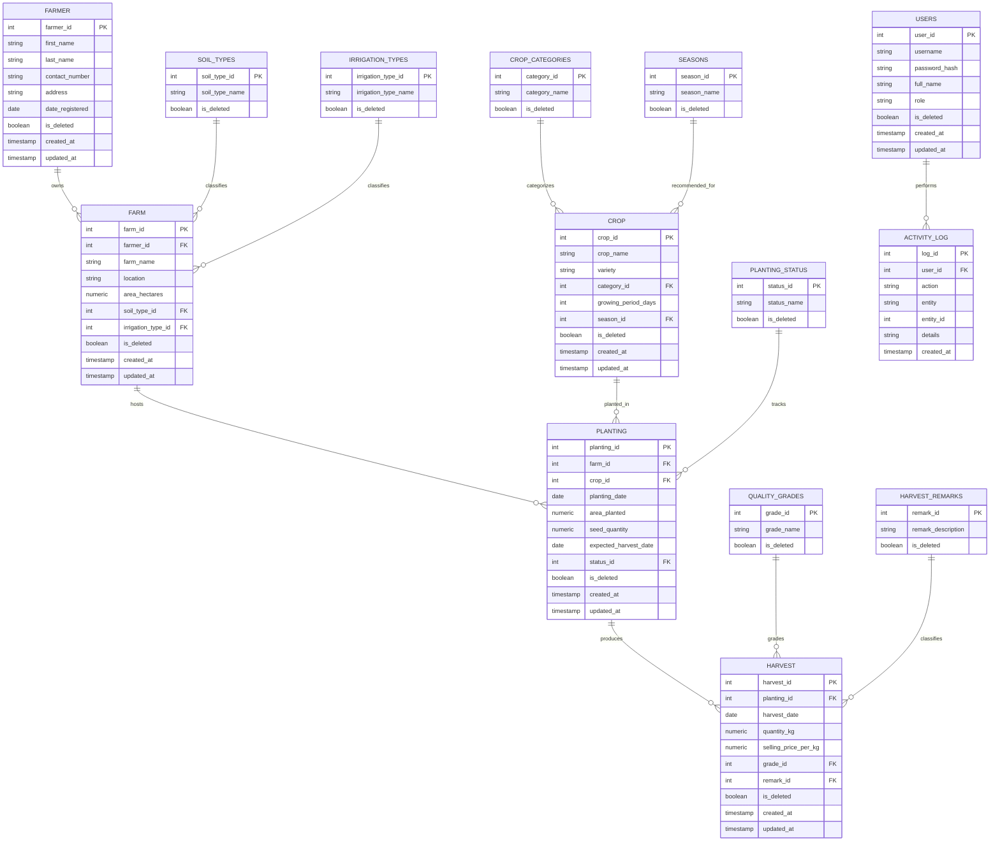

#  Agriculture Information System (AIS)
### Web Application Development (AP 3) — Midterm & Final Laboratory Project

[](https://www.php.net/)
[](https://tailwindcss.com/)
[-0ea5e9?style=for-the-badge&logo=tailwind-css&logoColor=white)](https://heroicons.com/)
[](https://supabase.com/)
[](https://opensource.org/licenses/MIT)

---

##  Project Overview

The **Agriculture Information System (AIS)** is a web-based database management application developed for **AP 3 (Web Application Development)**. It provides agricultural officers, farm managers, and administrative staff with centralized tools to manage farmers, farms, crop varieties, planting cycles, and harvest outputs — plus an analytics layer, user administration, and an activity audit trail.

The system runs on a fully normalized (3NF) **PostgreSQL** database — **13 normalized domain tables** (6 core entities + 7 lookup tables) **plus 1 supplementary system table** (`activity_log`, an append-only audit trail outside the normalization exercise) — hosted locally or on **Supabase**, built with modular native **PHP (PDO)** OOP classes, and styled with a clean white-theme **Tailwind CSS** UI using **Heroicons**, a custom app shell (sidebar + mobile bottom navigation), and vanilla-JS interaction layer (no frameworks, no Composer).

### Key Design Principles
- **Full 3NF normalization** — every predefined-value field lives in its own lookup table (13 domain tables).
- **Soft delete system-wide** — records are never physically removed; an `is_deleted` flag hides them while preserving history and referential integrity.
- **DB-driven dropdowns** — no hardcoded `<select>` options anywhere; all managed in a Settings module.
- **Audit trail** — `created_at` / `updated_at` timestamps on all core entities, plus a dedicated `activity_log` table recording every create/update/delete across the system.
- **No-reload UX** — sorting, filtering, pagination, record edits, and page-to-page navigation update in place via fetch/PJAX; native PHP form posts remain the fallback with JavaScript disabled.

---

##  Core Features & Modules

###  1. Farmer Management
- Full CRUD (soft delete) for registered farmers.
- Personal details: First Name, Last Name, Contact Number, Address, Registration Date.
- Search by farmer name or address.
- Deletion blocked while the farmer still owns active farms.

###  2. Farm Management
- Farm profile: Name, Location, Area (ha), Soil Type, Irrigation Type.
- Owner (`farmer_id`), Soil Type, and Irrigation Type selected from **database-driven dropdowns**.
- Lists display owner and lookup names via JOINs — never raw IDs.

###  3. Crop Catalog
- Crop Name, Variety, Category, Growing Period (days), Recommended Season.
- Category and Season are lookup-table dropdowns (`crop_categories`, `seasons`).

###  4. Planting Records
- Planting Date, Area Planted (ha), Seed Quantity (kg), Expected Harvest Date, Status.
- Status comes from the `planting_status` lookup (Planted / Growing / Harvested) with filterable list.
- Multi-table JOIN displays Farm, Crop, and Farmer names.
- Date validation: expected harvest date must fall after the planting date (app + DB CHECK constraint).

###  5. Harvest Records
- Harvest Date, Quantity (kg), Selling Price per kg, Quality Grade, Remark.
- Quality Grade (`quality_grades`) and Remark (`harvest_remarks`) are lookup dropdowns — the UI shows the description, the database stores the integer ID.
- Dynamic revenue: `Total Value = Quantity (kg) × Selling Price per kg`.
- Recording a harvest automatically marks the related planting as **Harvested**.

###  6. Settings (Lookup Table Management) — *Admin only*
- One place to manage all 7 lookup tables: Soil Types, Irrigation Types, Crop Categories, Seasons, Planting Status, Quality Grades, Harvest Remarks.
- Add, rename, and soft-delete dropdown values.
- Values in use by active records **cannot** be deleted; soft-deleted values disappear from dropdowns but remain joinable for historical records.

###  7. Dashboard (Analytics v2)
- Date-range selector (defaults to the last 12 months) scoping every chart and comparison KPI.
- KPI strip: revenue and harvested kg this month with %-vs-last-month comparisons, average yield per hectare, active plantings, harvest-due-within-14-days count, total farmers.
- Harvest volume (bar) and revenue (line) trend charts, top-5 crops by yield, top-5 farms by revenue.
- Right rail: upcoming harvests (days-left pills), recent plantings, recent harvests.
- All values are live queries against active (non-soft-deleted) records — nothing hard-coded or simulated.

###  8. Reports Engine (7 reports + live analytics overview)
- **Reports hub** is itself a one-page analytics overview: date-range KPI strip, a combo volume/revenue chart, plantings-by-status and harvests-by-grade doughnuts, a top-crops chart, and top-farms/top-farmers leaderboards, with the 7 detailed reports linked below it.
- **Farmers & Farm Ownership** — farm count and total hectares per farmer.
- **Crop Production per Farm** — harvested totals, filterable by farm.
- **Planting Cycle Status** — filterable by status.
- **Harvest Yield & Revenue** — date-range filter with SUM totals row.
- **Farmer Profitability** — harvest volume and revenue per farmer, ranked by revenue.
- **Seasonal Performance** — plantings, yield, and revenue share per season.
- **Yield Efficiency** — average kg harvested per hectare per crop, filterable by category.
- Every report is printable (print-friendly layout, navigation hidden) and **exportable to CSV** (`?export=csv`, with CSV-formula-injection guarding on every exported cell).

###  9. Administration — Users, Profile & Activity Log
- **User management** (admin-only): add/edit/deactivate accounts; soft delete blocks self-deactivation and the last active administrator; deactivated users cannot log in.
- **My Profile** (all roles): change display name and password, current password re-verified before any change is saved.
- **Activity Log** (admin-only): paginated audit trail of every create/update/delete across the system, filterable by user and record type, backed by the `activity_log` table.

###  10. Authentication & Access Control
- Session-based login with `password_hash` / `password_verify` (bcrypt).
- Role-Based Access Control:
  - **Administrator** — full CRUD, record deletion, Settings, Users, and the Activity Log.
  - **Staff** — data entry, viewing, updating, and reports (no deletes, no Settings/Users/Activity Log).
- Role checks enforced **server-side** on every delete endpoint and every admin-only module.

###  11. Data Integrity & Safety
- **Soft delete everywhere** — no `DELETE` statement exists in the codebase; deleting sets `is_deleted = TRUE`.
- Styled confirmation **modal** before every deletion (spec: Confirmation Before Deletion).
- Referential integrity: deletion is blocked while active child records exist (farmer→farms, farm→plantings, crop→plantings, planting→harvests, lookup→records using it) with a friendly message.
- Prepared statements on all queries; `htmlspecialchars()` on all output; CSV exports escape formula-injection characters.

###  12. Interface & Interaction Layer
- **Responsive app shell:** fixed desktop sidebar with a gooey liquid active-item indicator; mobile gets a gooey bottom navigation bar (goo-filtered active-tab bump) plus swipe-to-dismiss bottom sheets for Records (app-launcher icon grid) and Menu.
- **No-reload navigation:** list sorting, filtering, search, pagination, and record edits update in place via background fetch; app-wide PJAX swaps the main content on internal link clicks so the shell never flashes or reloads; a slim top progress bar (NProgress) and View Transitions smooth any remaining full loads.
- **Mobile-first data tables:** every list renders as scrollable cards on small screens and a sortable, paginated table on desktop, sharing one search/filter/sort toolbar.
- **Custom form controls:** every `<select>` is replaced by a styled dropdown panel; dropdowns with more than 10 options automatically become a search combobox; both cap at ~8 visible rows with the rest scrolling.
- **Context-aware empty states:** "no matches for your search/filter" (with a clear-filters link) is distinguished from "no records exist yet" (with an add-first-record action) everywhere.
- A soft pastel background wash, slide-in/pop-in motion on every modal and toast, and context-sensitive toasts complete the interface — all built with vanilla CSS/JS, respecting `prefers-reduced-motion`.

---

##  Database Normalization (UNF → 3NF, 13 Domain Tables)

> **Note on table count:** the normalization exercise below covers the **13 domain tables** (6 core entities + 7 lookups) per the course requirement. The schema additionally includes one supplementary **system table**, `activity_log` (14 tables total in `database/schema.sql`) — an append-only audit trail of create/update/delete actions. It is intentionally outside the normalization scope: it has no predefined-value fields to extract into lookups and exists purely to satisfy the system's audit/administration features.

```
[ Unnormalized Form (UNF) ]
          │  Remove repeating groups, ensure atomic fields, define Primary Keys
          ▼
[ First Normal Form (1NF) ]
          │  Remove partial functional dependencies (Composite Key separation)
          ▼
[ Second Normal Form (2NF) ]
          │  Remove transitive functional dependencies (Separate non-key entities
          │  and ALL predefined-value fields into lookup tables)
          ▼
[ Third Normal Form (3NF) ]  →  6 core entities + 7 lookup tables = 13 tables
```

### 1. Unnormalized Form (UNF)
A flat spreadsheet containing repeating groups: `Farmer_Details, Farm_Details, Crop_Details, Planting_Details, Harvest_Details` all in one table.

### 2. First Normal Form (1NF)
- All attributes atomic; repeating groups split into entities with primary keys (`farmer_id`, `farm_id`, `crop_id`, `planting_id`, `harvest_id`).

### 3. Second Normal Form (2NF)
- All non-key attributes fully functionally dependent on their table's primary key.
- `crop` and `farm` master data separated from `planting` / `harvest` transaction logs.

### 4. Third Normal Form (3NF)
- All transitive dependencies removed: every predefined-value description depends on its own lookup key, not on the transaction row. Each becomes a reference table storing an integer FK in the parent:

| # | Lookup Table | Referenced By | Replaces |
|---|--------------|---------------|----------|
| 1 | `soil_types` | `farm.soil_type_id` | free-text soil type |
| 2 | `irrigation_types` | `farm.irrigation_type_id` | free-text irrigation type |
| 3 | `crop_categories` | `crop.category_id` | free-text category |
| 4 | `seasons` | `crop.season_id` | free-text season |
| 5 | `planting_status` | `planting.status_id` | free-text status |
| 6 | `quality_grades` | `harvest.grade_id` | free-text grade |
| 7 | `harvest_remarks` | `harvest.remark_id` | free-text remarks |

---

##  Entity-Relationship Diagram (ERD)



> `activity_log` (shown above) is the supplementary 14th system table — see the note at the top of this section.

---

##  Project Architecture

```text
php-project-agriculture/
├── config/
│   ├── Database.php              # PDO connection (local defaults + env-var override) - gitignored
│   └── Database.example.php      # Committed credentials template
├── database/
│   └── schema.sql                # 14-table schema (13 domain + activity_log) + seed data
├── models/
│   ├── Farmer.php                # Farmer OOP model (soft delete, search, pagination)
│   ├── Farm.php                  # Farm model (lookup JOINs, search, pagination)
│   ├── Crop.php                  # Crop model (lookup JOINs, search, pagination)
│   ├── Planting.php              # Planting model (multi-table JOINs, status by name)
│   ├── Harvest.php               # Harvest model (grade + remark JOINs)
│   ├── Lookup.php                # Generic whitelisted model for all 7 lookup tables
│   └── User.php                  # Authentication + user management model
├── includes/
│   ├── header.php                # App shell: sidebar, topbar, mobile bottom nav, component CSS/JS
│   ├── footer.php                # PJAX engine, custom dropdown enhancer, closing tags
│   ├── auth_check.php            # Session guard (redirects to login)
│   ├── alert.php                 # Toast notification snippet (PJAX-safe init)
│   ├── confirm_modal.php         # Styled delete-confirmation modal
│   ├── sidecard.php              # Shared slide-over/slider: details card, list loader, edit-save
│   ├── table_helpers.php         # Pagination, whitelisted sorting, sortable headers
│   ├── report_helpers.php        # CSV export (formula-injection safe), print header, summary strip
│   ├── activity_log.php          # logActivity() audit-trail helper
│   └── form_response.php         # JSON vs. redirect response helper for edit-slider saves
├── farmers/                      # index (search/sort/paginate), create, edit, delete (soft)
├── farms/                        # index (search/filter/sort/paginate), create, edit, delete (soft)
├── crops/                        # index (search/filter/sort/paginate), create, edit, delete (soft)
├── plantings/                    # index (search/status filter/sort/paginate), create, edit, delete (soft)
├── harvests/                     # index (search/grade filter/sort/paginate), create, edit, delete (soft)
├── users/                        # Admin-only: index, create, edit, delete (soft), activity.php (audit log)
├── settings/                     # Admin-only lookup table management (index, edit, delete)
├── reports/
│   ├── index.php                 # Analytics overview (KPIs, charts) + links to the 7 detail reports
│   ├── farmers_farms.php         # Farmers & farm ownership
│   ├── crop_production.php       # Crop production per farm
│   ├── planting_status.php       # Planting cycle status
│   ├── harvest_revenue.php       # Harvest yield & revenue (date range + totals + CSV)
│   ├── farmer_profitability.php  # Revenue and volume per farmer
│   ├── seasonal_performance.php  # Plantings/yield/revenue per season
│   └── yield_efficiency.php      # kg harvested per hectare per crop
├── auth/
│   ├── login.php                 # Animated sign-in card (split rainbow background, floating labels)
│   ├── logout.php                # Session destroy
│   └── profile.php               # Change own name / password
├── index.php                     # Dashboard v2 (date-range KPIs, trend charts, upcoming harvests)
├── search.php                    # Global live search (farmers/farms/crops) + topbar dropdown endpoint
├── CODING_STANDARDS.md           # Teacher's coding conventions
├── DEVELOPMENT_PHASES.md         # Module-by-module build roadmap
├── PROJECT_STATUS.md             # Session continuity log — current project state, pending work
├── UI_STYLE_GUIDE.md             # White-theme UI rules
├── README.md                     # This file
└── .gitignore                    # Protects real database credentials
```

---

##  Technology Stack

| Component | Technology | Description |
| :--- | :--- | :--- |
| **Language** | PHP 8.1+ | Server-side logic with PDO (PHP Data Objects) |
| **Database** | PostgreSQL (local / Supabase) | 13-table 3NF domain schema + 1 supplementary audit table |
| **Styling** | Tailwind CSS (CDN) | White-theme, utility-first responsive UI |
| **Icons** | Heroicons (Tailwind Labs) | Inline SVG icon system |
| **Charts** | Chart.js 4 (CDN, SRI-pinned) | Dashboard and analytics-overview charts |
| **Progress** | NProgress (CDN, SRI-pinned) | Slim top loading bar for navigations and background fetches |
| **Interactivity** | Vanilla JavaScript | Custom dropdowns/comboboxes, PJAX navigation, slide-over sliders, mobile gooey nav — no JS framework |
| **Architecture** | Modular Native PHP + OOP Models | Database → Models → Module pages, no frameworks, no Composer |

---

##  Installation & Setup

### 1. Clone the Repository
```bash
git clone https://github.com/villariasa/php-project-agriculture.git
cd php-project-agriculture
```

### 2. Create the Database
Run `database/schema.sql` in your PostgreSQL client (pgAdmin / psql) or the Supabase SQL Editor. It creates all 14 tables (13 domain tables + `activity_log`) with constraints and seeds the lookups, sample records, and two user accounts. The script is safe to re-run — it drops and recreates everything.

### 3. Configure the Connection
Copy the template and fill in your credentials (the real file is gitignored):
```bash
cp config/Database.example.php config/Database.php
```
The class defaults to a local PostgreSQL connection and automatically picks up `DB_HOST`, `DB_PORT`, `DB_NAME`, `DB_USER`, `DB_PASS` environment variables for Supabase / production deployments.

### 4. Run the Development Server
```bash
php -S localhost:8000
```
Open `http://localhost:8000` — you will be redirected to the login page.

### 5. Default Accounts (seeded)

| Username | Password | Role |
| :--- | :--- | :--- |
| `admin` | `admin123` | Administrator (full access + Settings) |
| `staff` | `staff123` | Staff (no deletes, no Settings) |

> Change these credentials before any real deployment.

---

##  Author & Academic Information

- **Student Developer:** Medy Villarias (`villariasa`)
- **Institution:** Cebu Technological University (CTU) — Cebu City Campus
- **Course & Code:** AP 3 — Web Application Development
- **Project:** Agriculture Information System (AIS)

---

## License
This project is open-source under the [MIT License](LICENSE).
