# Agriculture Information System (AIS) — System Documentation

**Institution:** Cebu Technological University — Main Campus  
**College:** College of Computer, Information and Communications Technology (CCICT)  
**Course requirement:** AP3 Midterm Project — Agriculture Information Systems  
**Database Platform:** Supabase (Cloud PostgreSQL)  
**Application Stack:** Web-based Information System (PHP 8.2+, Bootstrap 5, Vanilla JS)  
**Architecture:** Fully Normalized Relational Model (3NF) — 13 Core & Lookup Tables  
**Academic Term:** First Semester, Academic Year 2024–2025  

---

## Table of Contents

1. [Project Title and Description](#1-project-title-and-description)
2. [Project Objectives](#2-project-objectives)
3. [Functional Requirements](#3-functional-requirements)
4. [Entity-Relationship Diagram (ERD) & Relationship Model](#4-entity-relationship-diagram-erd--relationship-model)
5. [Database Normalization Process (UNF → 1NF → 2NF → 3NF)](#5-database-normalization-process-unf--1nf--2nf--3nf)
6. [Comprehensive Data Dictionary](#6-comprehensive-data-dictionary)
7. [Table Relationships, Constraints, and Business Integrity Rules](#7-table-relationships-constraints-and-business-integrity-rules)
8. [Screenshots and User Interface Catalog](#8-screenshots-and-user-interface-catalog)
9. [System Testing Results & Quality Assurance Matrix](#9-system-testing-results--quality-assurance-matrix)
10. [User Guide / Operating Instructions](#10-user-guide--operating-instructions)
11. [Deployment & Technical Architecture](#11-deployment--technical-architecture)

---

## 1. Project Title and Description

**System Title:** Agriculture Information System (AIS)

**System Description:**

The **Agriculture Information System (AIS)** is an enterprise-grade, cloud-backed web application engineered to centralize, streamline, and optimize agricultural record-keeping for small-to-medium farming cooperatives, municipal agricultural offices, and farm managers. Operating across dynamic agricultural environments such as Cebu and Central Visayas, smallholder agricultural management has historically struggled with decentralized manual logbooks, paper receipts, fragmented farmer registries, and uncoordinated harvest tracking. These archaic workflows lead to data loss, inaccurate yield forecasts, pricing discrepancies, and an inability to track land productivity across seasons.

AIS overcomes these challenges by establishing a unified, relational digital repository hosted on **Supabase PostgreSQL**. The system integrates five core operational pillars: **Farmers**, **Farm Parcels**, **Crop Master Records**, **Planting Transactions**, and **Harvest Yields**. By incorporating strict Third Normal Form (3NF) architecture, controlled foreign-key lookup dropdowns, multi-tier role-based access control (Admin vs. Staff), automated transaction status transitions, and audit activity logging, AIS delivers real-time visibility into agricultural operations while enforcing the highest standards of data integrity.

## 2. Project Objectives

### 2.1 General Objective
To design, develop, and deploy a robust, secure, and fully normalized Agriculture Information System utilizing PHP and Supabase PostgreSQL that automates agricultural record management, improves production reporting, and provides actionable operational insights through an intuitive web interface.

### 2.2 Specific Objectives
- **Relational Database Normalization:** Design and implement a 3NF database schema comprising 13 tables (6 core entity tables and 7 reference lookup tables) to eliminate redundancy and insertion/update/deletion anomalies.
- **Cloud Database Integration:** Deploy and maintain the database on Supabase PostgreSQL, leveraging primary keys, foreign key referential integrity, and SQL domain CHECK constraints.
- **Complete CRUD Operations:** Develop responsive web interfaces supporting Create, Read, Update, and Soft-Delete operations across all five core operational modules.
- **Controlled Dropdown Vocabularies:** Eliminate arbitrary free-text entry by driving form selectors with dedicated lookup tables (Soil Types, Irrigation Methods, Crop Categories, Climate Seasons, Planting Statuses, Quality Grades, and Harvest Remarks).
- **Executive Dashboard Visualization:** Build a dynamic analytical dashboard featuring live metric cards, date interval filtering, active planting alerts, and recent harvest records.
- **Role-Based Access Control (RBAC):** Restrict system access through secure session authentication, separating administrative functions (User Management, Activity Log, Lookup Settings) from operational staff functions.
- **Multi-Layer Validation:** Implement validation across client-side HTML5/JavaScript, server-side PHP data filtering, and PostgreSQL check constraints.
- **Search, Filtering, and Sorting:** Implement live multi-column text search, dynamic dropdown filtering, and bidirectional column sorting across all tabular directories.
- **Operational Reporting & Export:** Develop 4 dedicated reporting modules (Farmers & Farms, Crop Production, Planting Status, Harvest & Revenue) featuring live parameter filtering and RFC 4180 CSV export.
- **Audit Trail Logging:** Capture every record creation, modification, and deletion in an append-only `activity_log` audit table for accountability.

## 3. Functional Requirements

| # | Requirement Name | Description & Functional Scope | Implementation Files | Authorized Roles |
| --- | --- | --- | --- | --- |
| FR1 | Farmer Profile Management | Register new farmers, view profile directories, edit personal/contact info, search/filter by name/address, and perform soft-deletion. | farmers/index.php, models/Farmer.php | Admin, Staff |
| FR2 | Farm Parcel Management | Register and maintain farm parcels linked to owning farmers, recording land area in hectares, and selecting soil/irrigation lookup types. | farms/index.php, models/Farm.php | Admin, Staff |
| FR3 | Crop Master Catalog | Manage catalog of agricultural crops, varieties, botanical categories, maturity cycle durations (days), and optimal growing seasons. | crops/index.php, models/Crop.php | Admin, Staff |
| FR4 | Planting Transactions | Record agricultural planting activities linking parcels to crops, tracking ground area planted, seed quantities, and expected harvest dates. | plantings/index.php, models/Planting.php | Admin, Staff |
| FR5 | Harvest Transactions | Record harvest outputs linked to plantings, logging yield quantity (kg), unit selling price, quality grades, and remarks. Automatically updates planting status. | harvests/index.php, models/Harvest.php | Admin, Staff |
| FR6 | Executive Dashboard | Real-time summary KPI cards (total farmers, farms, crops, active plantings, harvests, revenue), date range filtering, recent activity, and quick navigation. | index.php | Admin, Staff |
| FR7 | Authentication & Session | Secure authentication enforcing encrypted bcrypt passwords, session token management, and automatic unauthenticated redirection. | auth/login.php, auth/logout.php, includes/auth_check.php | All Users |
| FR8 | Role-Based Access Control | Enforce strict privilege boundaries where Admin accounts access user management and lookup settings, while Staff is restricted to operational modules. | includes/auth_check.php, users/*.php, settings/*.php | Enforced System-wide |
| FR9 | Search, Filter & Sorting | Multi-column live search, dropdown filtering (by address, irrigation, category, status, grade), and ascending/descending table sorting. | includes/table_helpers.php, all module index.php files | Admin, Staff |
| FR10 | Operational Reports & CSV | Generate four dedicated reporting suites: Farmers & Farms, Crop Production, Planting Status, and Harvest & Revenue with live CSV export capabilities. | reports/*.php, includes/report_helpers.php | Admin, Staff |
| FR11 | Controlled Dropdowns | Enforce data integrity by replacing arbitrary text fields with controlled dropdowns backed by foreign key lookup tables. | models/Lookup.php, all create/edit modal views | Admin, Staff |
| FR12 | Destructive Action Safety | Prevent accidental data loss via client-side confirmation modals before soft-deleting any record, with referential integrity enforcement. | includes/confirm_modal.php, assets/js/main.js | Admin, Staff |
| FR13 | Audit Trail Logging | Persist comprehensive audit logs recording who (user ID), what action (create/update/delete), which entity, and timestamp for all transactions. | includes/activity_log.php, database activity_log, users/activity.php | Admin Only |
| FR14 | Responsive Interface | Adaptive interface supporting mobile, tablet, and desktop views with persistent bottom navigation bar on mobile viewports. | includes/header.php, assets/css/style.css | All Users |


## 4. Entity-Relationship Diagram (ERD) & Relationship Model

### 4.1 Conceptual Entity Architecture

The AIS database architecture is organized into **6 core business entity tables** and **7 reference lookup tables**, linked via strict foreign key relationships:

```
[FARMER] (1) ──< (M) [FARM] (1) ──< (M) [PLANTING] (1) ──< (M) [HARVEST]
                       │                       │                     │
               [soil_types] (M:1)         [crop] (M:1)       [quality_grades] (M:1)
            [irrigation_types] (M:1)           │             [harvest_remarks] (M:1)
                                        [crop_categories] (M:1)
                                           [seasons] (M:1)
                                       [planting_status] (M:1)

[USERS] (1) ──< (M) [ACTIVITY_LOG]
```

### 4.2 Comprehensive Relationship & Cardinality Summary

| Parent Table | Child Table | Cardinality | Foreign Key Column | Relationship Description |
| --- | --- | --- | --- | --- |
| farmer | farm | 1 : M (One-to-Many) | farm.farmer_id | A single farmer can own and manage multiple registered farm parcels. |
| farm | planting | 1 : M (One-to-Many) | planting.farm_id | A farm parcel hosts multiple seasonal planting cycles over time. |
| crop | planting | 1 : M (One-to-Many) | planting.crop_id | A crop master entry is referenced across numerous planting records. |
| planting | harvest | 1 : M (One-to-Many) | harvest.planting_id | A planting cycle yields one or more harvest batches. |
| soil_types | farm | 1 : M (One-to-Many) | farm.soil_type_id | A soil type classification characterizes multiple farm parcels. |
| irrigation_types | farm | 1 : M (One-to-Many) | farm.irrigation_type_id | An irrigation infrastructure method is applied to multiple farms. |
| crop_categories | crop | 1 : M (One-to-Many) | crop.category_id | A crop category groups multiple crop species. |
| seasons | crop | 1 : M (One-to-Many) | crop.season_id | A seasonal climate condition applies to multiple crop types. |
| planting_status | planting | 1 : M (One-to-Many) | planting.status_id | A workflow status tracks the lifecycle state of plantings. |
| quality_grades | harvest | 1 : M (One-to-Many) | harvest.grade_id | A commercial quality standard categorizes harvest yields. |
| harvest_remarks | harvest | 1 : M (One-to-Many) | harvest.remark_id | A controlled assessment remark describes harvest outcomes. |
| users | activity_log | 1 : M (One-to-Many) | activity_log.user_id | A system user account generates multiple audit log entries. |


## 5. Database Normalization Process (UNF → 1NF → 2NF → 3NF)

### 5.1 Unnormalized Form (UNF)

Prior to normalization, traditional agricultural records existed as flat log sheets where multiple crops and harvest events were crammed into single rows alongside farmer and parcel details. This created severe **repeating groups** and **non-atomic attributes**.

| Farmer Name | Contact | Farm Location | Farm Name & Type | Crops Planted (Repeating Group) | Harvest Transactions (Repeating Group) |
| --- | --- | --- | --- | --- | --- |
| Juan Dela Cruz | 09171234567 | Poblacion, Carcar City, Cebu | Green Valley Rice Farm<br>(Clay Loam, Irrigated) | • Rice (RC-222, Cereal, Wet Season, 115d): 2024-06-10, 2.5 ha, 100 kg<br>• Yellow Corn (Pioneer 30T80, Dry Season, 105d): 2024-10-15, 1.0 ha, 20 kg | • Rice: 2024-10-05, 8,200 kg @ ₱24.50/kg, Grade A, Good Harvest<br>• Corn: 2025-01-28, 3,500 kg @ ₱18.00/kg, Grade B, Acceptable Quality |
| Maria Santos | 09182345678 | Mantalongon, Dalaguete, Cebu | Sunrise Highland Vegetable Farm<br>(Sandy Loam, Rainfed) | • Cabbage (Scorpio Hybrid, Vegetable, Dry Season, 65d): 2024-08-01, 1.5 ha, 15 kg<br>• Tomato (Diamante Max, Dry Season, 75d): 2024-11-01, 1.3 ha, 10 kg | • Cabbage: 2024-10-10, 6,400 kg @ ₱35.00/kg, Grade A, Good Harvest<br>• Tomato: 2025-01-20, 4,200 kg @ ₱45.00/kg, Grade A, Good Harvest |

**Identified Anomalies in UNF:**
- **Insertion Anomaly:** A new crop variety or soil type cannot be added without first registering a farmer and a harvest transaction.
- **Update Anomaly:** Modifying a farmer's contact number requires editing every historical row containing that farmer.
- **Deletion Anomaly:** Deleting a past harvest transaction inadvertently deletes the farmer's biographical profile.

### 5.2 First Normal Form (1NF)

To achieve **1NF**, all repeating groups are decomposed into individual rows, and each column is guaranteed to store strictly **atomic** values. A composite primary key `(farmer_name, farm_name, crop_name, planting_date, harvest_date)` identifies each record.

| Farmer | Contact | Farm Name | Soil | Irrigation | Crop | Variety | Planted | Area | Harvest Date | Yield (kg) | Price | Grade | Remark |
| --- | --- | --- | --- | --- | --- | --- | --- | --- | --- | --- | --- | --- | --- |
| Juan Dela Cruz | 09171234567 | Green Valley Rice Farm | Clay Loam | Irrigated | Rice | RC-222 | 2024-06-10 | 2.5 ha | 2024-10-05 | 8,200 | ₱24.50 | Grade A | Good Harvest |
| Juan Dela Cruz | 09171234567 | Green Valley Rice Farm | Clay Loam | Irrigated | Yellow Corn | Pioneer 30T80 | 2024-10-15 | 1.0 ha | 2025-01-28 | 3,500 | ₱18.00 | Grade B | Acceptable Quality |
| Maria Santos | 09182345678 | Sunrise Highland Farm | Sandy Loam | Rainfed | Cabbage | Scorpio Hybrid | 2024-08-01 | 1.5 ha | 2024-10-10 | 6,400 | ₱35.00 | Grade A | Good Harvest |
| Maria Santos | 09182345678 | Sunrise Highland Farm | Sandy Loam | Rainfed | Tomato | Diamante Max | 2024-11-01 | 1.3 ha | 2025-01-20 | 4,200 | ₱45.00 | Grade A | Good Harvest |


### 5.3 Second Normal Form (2NF)

To achieve **2NF**, all **partial functional dependencies** are eliminated. Non-key attributes must depend on the *entire* candidate primary key, rather than a subset:

- `farmer_contact`, `address` depend solely on `farmer_id` → Moved to **FARMER** entity.
- `farm_name`, `location`, `area_hectares` depend solely on `farm_id` → Moved to **FARM** entity.
- `crop_name`, `variety`, `growing_period_days` depend solely on `crop_id` → Moved to **CROP** entity.
- `planting_date`, `area_planted`, `seed_quantity` depend on `planting_id` → Moved to **PLANTING** transaction entity.
- `harvest_date`, `quantity_kg`, `selling_price_per_kg` depend on `harvest_id` → Moved to **HARVEST** transaction entity.

### 5.4 Third Normal Form (3NF)

To achieve **3NF**, all **transitive functional dependencies** ($X \rightarrow Y$ where $Y$ is a non-key attribute depending on non-key attribute $X$) are extracted into dedicated reference lookup tables:

- `farm` $\rightarrow$ `soil_type_id` $\rightarrow$ `soil_type_name` extracted to **soil_types**.
- `farm` $\rightarrow$ `irrigation_type_id` $\rightarrow$ `irrigation_type_name` extracted to **irrigation_types**.
- `crop` $\rightarrow$ `category_id` $\rightarrow$ `category_name` extracted to **crop_categories**.
- `crop` $\rightarrow$ `season_id` $\rightarrow$ `season_name` extracted to **seasons**.
- `planting` $\rightarrow$ `status_id` $\rightarrow$ `status_name` extracted to **planting_status**.
- `harvest` $\rightarrow$ `grade_id` $\rightarrow$ `grade_name` extracted to **quality_grades**.
- `harvest` $\rightarrow$ `remark_id` $\rightarrow$ `remark_description` extracted to **harvest_remarks**.

Every non-key attribute in every table now depends *strictly on the key, the whole key, and nothing but the key*. This results in **13 total normalized tables**.

### 5.5 Controlled Vocabulary Reference Tables (Lookup Architecture)

#### Lookup Table: Harvest Remarks
*Standardized crop yield outcome and physical condition remarks.*

| remark_id | remark_description | Agricultural Evaluation Criteria |
| --- | --- | --- |
| 1 | Good Harvest | Produce exceeds standard quality and yield benchmarks with zero pest damage. |
| 2 | Acceptable Quality | Commercial quality meets standard market specifications with minor aesthetic variances. |
| 3 | Low Yield | Yield quantity lower than forecasted expectations due to climatic or soil factors. |
| 4 | Poor Quality | Produce affected by physical defects, sub-optimal sizing, or handling damage. |
| 5 | Damaged Harvest | Crop damaged by severe weather, pest infestation, or plant disease outbreaks. |


#### Lookup Table: Soil Types
*Standardized soil texture classifications for farm parcels.*

| soil_type_id | soil_type_name | Characteristics & Best Suited Crops |
| --- | --- | --- |
| 1 | Clay Loam | Balanced mix of clay, silt, and sand; excellent nutrient retention for rice and corn. |
| 2 | Sandy Loam | Fast draining and warm; highly suited for vegetable crops and legumes. |
| 3 | Silt Loam | High fertility and moisture retention; optimal for leafy vegetables and cereals. |
| 4 | Loam | Ideal agricultural soil texture; supports universal crop rotation and orchards. |
| 5 | Clay | Dense water-holding capacity; optimal for lowland irrigated rice cultivation. |
| 6 | Sandy | Rapid percolation and low organic matter; suitable for root crops with irrigation. |


#### Lookup Table: Irrigation Types
*Agricultural water delivery and irrigation methodologies.*

| irrigation_type_id | irrigation_type_name | Operational Delivery Description |
| --- | --- | --- |
| 1 | Irrigated | Canal or pump gravity-fed system providing reliable, continuous water flow. |
| 2 | Rainfed | Natural precipitation-dependent farming without artificial conveyance infrastructure. |
| 3 | Drip | Targeted low-pressure emitter system delivering water directly to crop root zones. |
| 4 | Sprinkler | Overhead pressurized nozzle distribution simulating artificial rainfall. |


#### Lookup Table: Crop Categories
*Broad agronomic and botanical classifications.*

| category_id | category_name | Classification Scope & Examples |
| --- | --- | --- |
| 1 | Cereal | Staple grain crops cultivated for edible seeds (e.g., Rice, Yellow Corn, White Corn). |
| 2 | Legume | Nitrogen-fixing pod crops cultivated for pulses (e.g., Mungbean, Peanut, String Bean). |
| 3 | Root Crop | Underground edible storage tuber and root crops (e.g., Sweet Potato, Cassava). |
| 4 | Fruit | Perennial and seasonal horticultural fruit crops (e.g., Mango, Papaya, Banana). |
| 5 | Vegetable | Nutritional culinary plant crops (e.g., Tomato, Eggplant, Cabbage, Bell Pepper). |


#### Lookup Table: Seasons
*Tropical agro-climatic growing seasons in the Philippines.*

| season_id | season_name | Climatic Window & Agronomic Context |
| --- | --- | --- |
| 1 | Dry Season | Period of low precipitation (November to April); ideal for irrigated cereals and solanaceous crops. |
| 2 | Wet Season | Monsoon rainy period (May to October); optimal for rainfed lowland rice and robust field crops. |
| 3 | Year Round | Tolerant cultivars capable of sustained continuous production throughout all calendar months. |


#### Lookup Table: Planting Status
*Lifecycle phases tracking crop development from field sowing to harvest.*

| status_id | status_name | Lifecycle Stage & Operational Rule |
| --- | --- | --- |
| 1 | Planted | Initial field phase: seeds sown or seedlings transplanted; monitoring germination. |
| 2 | Growing | Vegetative growth and flowering phase; active fertilizer and pest management applied. |
| 3 | Harvested | Terminal phase: maturity reached and yield gathered; automatically updated by harvest log. |


#### Lookup Table: Quality Grades
*Standardized commercial grading tiers for agricultural commodities.*

| grade_id | grade_name | Market Quality Specification |
| --- | --- | --- |
| 1 | Grade A | Premium export/supermarket grade: uniform size, flawless appearance, peak ripeness. |
| 2 | Grade B | Standard wholesale/retail grade: sound internal quality with minor surface blemishes. |
| 3 | Grade C | Processing or discount grade: non-uniform size or cosmetic defects; fully edible. |


## 6. Comprehensive Data Dictionary

The system data dictionary defines the physical PostgreSQL schema implemented in Supabase, detailing every column, data type, integrity constraints, and operational business rules.

### Table: `farmer`
*Stores core biographical and contact profiles of registered agricultural producers.*

| Column Name | Data Type | Constraints | Default | Description & Field Rules |
| --- | --- | --- | --- | --- |
| farmer_id | SERIAL | PRIMARY KEY, NOT NULL | NextVal() | Surrogate primary key uniquely identifying each farmer. |
| first_name | VARCHAR(50) | NOT NULL | None | Given legal first name of the registered farmer. |
| last_name | VARCHAR(50) | NOT NULL | None | Family name or surname of the registered farmer. |
| contact_number | VARCHAR(20) | NOT NULL | None | Active primary mobile or telephone contact number. |
| address | VARCHAR(150) | NOT NULL | None | Barangay, municipality, and provincial residence address. |
| date_registered | DATE | NOT NULL | CURRENT_DATE | Calendar date the farmer was registered into the system. |
| is_deleted | BOOLEAN | NOT NULL | FALSE | Soft delete flag: TRUE marks record archived/hidden. |
| created_at | TIMESTAMP | NOT NULL | NOW() | System timestamp marking initial record creation. |
| updated_at | TIMESTAMP | NOT NULL | NOW() | System timestamp recording most recent record update. |


### Table: `farm`
*Stores land parcel information, agricultural properties, and references to the owning farmer.*

| Column Name | Data Type | Constraints | Default | Description & Field Rules |
| --- | --- | --- | --- | --- |
| farm_id | SERIAL | PRIMARY KEY, NOT NULL | NextVal() | Surrogate primary key uniquely identifying each farm parcel. |
| farmer_id | INT | NOT NULL, FK -> farmer(farmer_id) | None | Foreign key linking parcel to registered owner (1:M). |
| farm_name | VARCHAR(100) | NOT NULL | None | Official or popular name of the agricultural farm parcel. |
| location | VARCHAR(150) | NOT NULL | None | Sitio/Barangay and Municipality where farm is situated. |
| area_hectares | NUMERIC(10,2) | NOT NULL, CHECK (> 0) | None | Total cultivable land area in hectares (must be positive). |
| soil_type_id | INT | NOT NULL, FK -> soil_types(soil_type_id) | None | Foreign key reference to controlled soil type lookup. |
| irrigation_type_id | INT | NOT NULL, FK -> irrigation_types(irrigation_type_id) | None | Foreign key reference to controlled irrigation lookup. |
| is_deleted | BOOLEAN | NOT NULL | FALSE | Soft delete flag for safe record deactivation. |
| created_at | TIMESTAMP | NOT NULL | NOW() | System timestamp recording initial insertion. |
| updated_at | TIMESTAMP | NOT NULL | NOW() | System timestamp recording latest modification. |


### Table: `crop`
*Maintains agricultural crop master data, botanical varieties, and agronomic cycles.*

| Column Name | Data Type | Constraints | Default | Description & Field Rules |
| --- | --- | --- | --- | --- |
| crop_id | SERIAL | PRIMARY KEY, NOT NULL | NextVal() | Surrogate primary key identifying the crop species/variety. |
| crop_name | VARCHAR(100) | NOT NULL | None | Common commodity name (e.g., Rice, Yellow Corn, Tomato). |
| variety | VARCHAR(100) | NOT NULL | None | Specific cultivar or hybrid designation (e.g., RC-222, Diamante Max). |
| category_id | INT | NOT NULL, FK -> crop_categories(category_id) | None | Foreign key categorizing crop (Cereal, Legume, Fruit, etc.). |
| growing_period_days | INT | NOT NULL, CHECK (> 0) | None | Average days required from planting to harvest maturity. |
| season_id | INT | NOT NULL, FK -> seasons(season_id) | None | Foreign key specifying optimal agronomic climate season. |
| is_deleted | BOOLEAN | NOT NULL | FALSE | Soft delete flag for archiving retired crop varieties. |
| created_at | TIMESTAMP | NOT NULL | NOW() | System audit timestamp at creation. |
| updated_at | TIMESTAMP | NOT NULL | NOW() | System audit timestamp at latest update. |


### Table: `planting`
*Records agricultural planting operational cycles, linking parcels to crops and tracking schedule.*

| Column Name | Data Type | Constraints | Default | Description & Field Rules |
| --- | --- | --- | --- | --- |
| planting_id | SERIAL | PRIMARY KEY, NOT NULL | NextVal() | Surrogate primary key for the planting transaction record. |
| farm_id | INT | NOT NULL, FK -> farm(farm_id) | None | Foreign key linking planting event to host farm parcel. |
| crop_id | INT | NOT NULL, FK -> crop(crop_id) | None | Foreign key linking to specific crop variety planted. |
| planting_date | DATE | NOT NULL | None | Calendar date on which seeds or seedlings were planted. |
| area_planted | NUMERIC(10,2) | NOT NULL, CHECK (> 0) | None | Physical ground area allocated in hectares. |
| seed_quantity | NUMERIC(10,2) | NOT NULL, CHECK (> 0) | None | Weight of seed stock or seedlings utilized in kilograms. |
| expected_harvest_date | DATE | NOT NULL, CHECK (> planting_date) | None | Projected completion date; must strictly succeed planting_date. |
| status_id | INT | NOT NULL, FK -> planting_status(status_id) | None | Lifecycle phase: Planted, Growing, or Harvested. |
| is_deleted | BOOLEAN | NOT NULL | FALSE | Soft delete flag preserving historical relationship integrity. |
| created_at | TIMESTAMP | NOT NULL | NOW() | Audit creation timestamp. |
| updated_at | TIMESTAMP | NOT NULL | NOW() | Audit last-modified timestamp. |


### Table: `harvest`
*Captures agricultural harvest production yields, commodity valuation, and quality remarks.*

| Column Name | Data Type | Constraints | Default | Description & Field Rules |
| --- | --- | --- | --- | --- |
| harvest_id | SERIAL | PRIMARY KEY, NOT NULL | NextVal() | Surrogate primary key identifying the harvest yield transaction. |
| planting_id | INT | NOT NULL, FK -> planting(planting_id) | None | Foreign key identifying originating planting cycle. |
| harvest_date | DATE | NOT NULL | None | Actual calendar date on which crops were harvested. |
| quantity_kg | NUMERIC(10,2) | NOT NULL, CHECK (> 0) | None | Net weight of crops harvested in kilograms. |
| selling_price_per_kg | NUMERIC(10,2) | NOT NULL, CHECK (> 0) | None | Realized or market price per kilogram in Philippine Pesos (PHP). |
| grade_id | INT | NOT NULL, FK -> quality_grades(grade_id) | None | Foreign key referencing commercial grading tier. |
| remark_id | INT | NOT NULL, FK -> harvest_remarks(remark_id) | None | Foreign key referencing standardized condition remark. |
| is_deleted | BOOLEAN | NOT NULL | FALSE | Soft delete flag. |
| created_at | TIMESTAMP | NOT NULL | NOW() | Audit creation timestamp. |
| updated_at | TIMESTAMP | NOT NULL | NOW() | Audit last-modified timestamp. |


### Table: `users`
*Stores authorized system user credentials, display names, and role-based permissions.*

| Column Name | Data Type | Constraints | Default | Description & Field Rules |
| --- | --- | --- | --- | --- |
| user_id | SERIAL | PRIMARY KEY, NOT NULL | NextVal() | Surrogate primary key identifying the user account. |
| username | VARCHAR(50) | NOT NULL, UNIQUE | None | Unique alphanumeric operator login identifier. |
| password_hash | VARCHAR(255) | NOT NULL | None | One-way cryptographic hash generated via bcrypt. |
| full_name | VARCHAR(100) | NOT NULL | None | Official full name displayed in application headers and logs. |
| role | VARCHAR(20) | NOT NULL, CHECK IN ('admin','staff') | 'staff' | Access tier: 'admin' has full privileges; 'staff' has standard CRUD. |
| is_deleted | BOOLEAN | NOT NULL | FALSE | Soft delete flag for terminating account access. |
| created_at | TIMESTAMP | NOT NULL | NOW() | Account registration timestamp. |
| updated_at | TIMESTAMP | NOT NULL | NOW() | Account update timestamp. |


### Table: `activity_log`
*Maintains an immutable audit trail of all insert, update, and soft-delete transactions.*

| Column Name | Data Type | Constraints | Default | Description & Field Rules |
| --- | --- | --- | --- | --- |
| log_id | SERIAL | PRIMARY KEY, NOT NULL | NextVal() | Sequential log event identifier. |
| user_id | INT | NOT NULL, FK -> users(user_id) | None | Identifies the user account that triggered the system change. |
| action | VARCHAR(20) | NOT NULL, CHECK IN ('create','update','delete') | None | Classification of mutation performed. |
| entity | VARCHAR(50) | NOT NULL | None | Target module or table name (e.g., 'farmer', 'harvest'). |
| entity_id | INT | NOT NULL | None | Primary key integer of the record impacted by the operation. |
| details | VARCHAR(200) | NOT NULL | '' | Human-readable summary or audit snapshot of altered values. |
| created_at | TIMESTAMP | NOT NULL | NOW() | System timestamp indicating exact time of mutation. |


### Table: `soil_types`
*Lookup table specifying standardized soil classifications for agricultural parcels.*

| Column Name | Data Type | Constraints | Default | Description & Field Rules |
| --- | --- | --- | --- | --- |
| soil_type_id | SERIAL | PRIMARY KEY, NOT NULL | NextVal() | Surrogate primary key for soil classification code. |
| soil_type_name | VARCHAR(50) | NOT NULL | None | Soil name (Clay Loam, Sandy Loam, Silt Loam, Loam, Clay, Sandy). |
| is_deleted | BOOLEAN | NOT NULL | FALSE | Soft delete flag for lookup value maintenance. |


### Table: `irrigation_types`
*Lookup table specifying recognized agricultural water delivery systems.*

| Column Name | Data Type | Constraints | Default | Description & Field Rules |
| --- | --- | --- | --- | --- |
| irrigation_type_id | SERIAL | PRIMARY KEY, NOT NULL | NextVal() | Surrogate primary key for irrigation type code. |
| irrigation_type_name | VARCHAR(50) | NOT NULL | None | Irrigation system (Irrigated, Rainfed, Drip, Sprinkler). |
| is_deleted | BOOLEAN | NOT NULL | FALSE | Soft delete flag for lookup value maintenance. |


### Table: `crop_categories`
*Lookup table grouping crop botanical classifications.*

| Column Name | Data Type | Constraints | Default | Description & Field Rules |
| --- | --- | --- | --- | --- |
| category_id | SERIAL | PRIMARY KEY, NOT NULL | NextVal() | Surrogate primary key for crop category code. |
| category_name | VARCHAR(50) | NOT NULL | None | Category label (Cereal, Legume, Root Crop, Fruit, Vegetable). |
| is_deleted | BOOLEAN | NOT NULL | FALSE | Soft delete flag for lookup value maintenance. |


### Table: `seasons`
*Lookup table specifying tropical climate seasons in the Philippines.*

| Column Name | Data Type | Constraints | Default | Description & Field Rules |
| --- | --- | --- | --- | --- |
| season_id | SERIAL | PRIMARY KEY, NOT NULL | NextVal() | Surrogate primary key for season code. |
| season_name | VARCHAR(50) | NOT NULL | None | Season designation (Dry Season, Wet Season, Year Round). |
| is_deleted | BOOLEAN | NOT NULL | FALSE | Soft delete flag for lookup value maintenance. |


### Table: `planting_status`
*Lookup table governing the operational status of crop planting batches.*

| Column Name | Data Type | Constraints | Default | Description & Field Rules |
| --- | --- | --- | --- | --- |
| status_id | SERIAL | PRIMARY KEY, NOT NULL | NextVal() | Surrogate primary key for planting status code. |
| status_name | VARCHAR(50) | NOT NULL | None | Lifecycle status name (Planted, Growing, Harvested). |
| is_deleted | BOOLEAN | NOT NULL | FALSE | Soft delete flag for lookup value maintenance. |


### Table: `quality_grades`
*Lookup table establishing commercial commodity quality grades.*

| Column Name | Data Type | Constraints | Default | Description & Field Rules |
| --- | --- | --- | --- | --- |
| grade_id | SERIAL | PRIMARY KEY, NOT NULL | NextVal() | Surrogate primary key for produce quality grade. |
| grade_name | VARCHAR(50) | NOT NULL | None | Commercial standard designation (Grade A, Grade B, Grade C). |
| is_deleted | BOOLEAN | NOT NULL | FALSE | Soft delete flag for lookup value maintenance. |


### Table: `harvest_remarks`
*Lookup table establishing standardized crop condition remarks upon harvest.*

| Column Name | Data Type | Constraints | Default | Description & Field Rules |
| --- | --- | --- | --- | --- |
| remark_id | SERIAL | PRIMARY KEY, NOT NULL | NextVal() | Surrogate primary key for harvest remark code. |
| remark_description | VARCHAR(100) | NOT NULL | None | Standardized outcome remark (Good Harvest, Acceptable Quality, Low Yield, Poor Quality, Damaged Harvest). |
| is_deleted | BOOLEAN | NOT NULL | FALSE | Soft delete flag for lookup value maintenance. |


## 7. Table Relationships, Constraints, and Business Integrity Rules

### 7.1 Domain & Relational Integrity Constraints

| Table Name | Constraint Name / Type | Constraint Expression / Condition | Enforced Business Rule |
| --- | --- | --- | --- |
| farm | CHECK (area_hectares) | area_hectares > 0 | Enforces that farm land parcel size must strictly be a positive real number. |
| crop | CHECK (growing_period_days) | growing_period_days > 0 | Ensures maturity cycle in days is strictly positive. |
| planting | CHECK (area_planted) | area_planted > 0 | Area cultivated in hectares must be positive. |
| planting | CHECK (seed_quantity) | seed_quantity > 0 | Seed weight utilized in kg must be greater than zero. |
| planting | CHECK (chk_harvest_after_planting) | expected_harvest_date > planting_date | Guarantees chronological validity; expected harvest cannot precede planting date. |
| harvest | CHECK (quantity_kg) | quantity_kg > 0 | Harvested crop weight in kg must be greater than zero. |
| harvest | CHECK (selling_price_per_kg) | selling_price_per_kg > 0 | Price per kg in Philippine Pesos (PHP) must be positive. |
| users | CHECK (role) | role IN ('admin', 'staff') | Restricts account authorization to strictly defined role tiers. |
| users | UNIQUE (username) | UNIQUE (username) | Guarantees unique login usernames across all system accounts. |
| activity_log | CHECK (action) | action IN ('create', 'update', 'delete') | Restricts audit transaction operations to standard CRUD verbs. |
| all tables | BOOLEAN DEFAULT FALSE | is_deleted = FALSE | Preserves referential integrity via soft-deletion instead of destructive hard deletes. |


### 7.2 Referential Action & Soft-Delete Architecture

- **Surrogate Primary Keys:** All tables utilize auto-incrementing `SERIAL` primary keys (`_id`) for maximum indexing speed and decoupled relational joins.
- **Foreign Key Integrity:** All relationships enforce strict PostgreSQL `REFERENCES` declarations. To protect historical agricultural reports and audit trails, records are never hard-deleted.
- **Soft-Delete Implementation:** Every core and lookup table features an `is_deleted BOOLEAN NOT NULL DEFAULT FALSE` column. User delete actions update `is_deleted = TRUE`, instantly excluding records from active application views while fully preserving relational integrity for historical calculations and harvests.
- **Audit Timestamps:** Every entity table incorporates `created_at` and `updated_at` timestamps defaulting to `NOW()`, maintained via database triggers and PHP model handlers.

## 8. Screenshots of the Working System

The Agriculture Information System user interface is engineered with **Bootstrap 5** and custom emerald agricultural CSS, providing responsive layouts for desktop, tablet, and mobile devices.

### 8.1 User Interface Catalog Summary

| # | Module / View | Script File / URI | Interface Layout Description | Key UI Elements & Actions |
| --- | --- | --- | --- | --- |
| 1 | Authentication Login | auth/login.php | Clean centered login card with brand logo and credentials form. | Username, password, Remember Me, submit button, error banner. |
| 2 | Executive Dashboard | index.php | High-level KPI metric cards, date range filter, and recent activities. | 5 Metric cards, active plantings alert, recent harvests table. |
| 3 | Farmers Management | farmers/index.php | Split layout: tabular directory on left, add-farmer card on right. | Search input, address filter, sortable columns, edit/delete modals. |
| 4 | Farms Management | farms/index.php | Comprehensive parcel directory joined with farmer owner and soil/irrigation. | Farmer dropdown, soil/irrigation lookups, area validation. |
| 5 | Crop Master Catalog | crops/index.php | Directory of agronomic crops with category, season, and cycle duration. | Category & season selectors, maturity days input, action buttons. |
| 6 | Planting Records | plantings/index.php | Transaction management interface linking farms and crops. | Farm & crop dropdowns, planting & harvest date pickers, status badge. |
| 7 | Harvest Records | harvests/index.php | Yield transaction log displaying quantity, revenue, and quality grading. | Planting picker, quantity input, unit price, grade/remark lookups. |
| 8 | Add/Edit Modal Forms | Multiple modal components | Standardized Bootstrap dialog with real-time field validation. | Clean floating labels, error feedback states, save/cancel buttons. |
| 9 | Delete Confirmation Dialog | includes/confirm_modal.php | Two-step confirmation modal preventing unintended record deletion. | Destructive action warning text, entity title, Cancel & Confirm buttons. |
| 10 | Report: Farmers & Farms | reports/farmers_farms.php | Consolidated report showing farmer ownership and total land holdings. | Search filter, summary totals, print and Export CSV actions. |
| 11 | Report: Crop Production | reports/crop_production.php | Production statistics filtered by individual farm parcels. | Farm parcel selector, crop yield aggregation, Export CSV button. |
| 12 | Report: Planting Status | reports/planting_status.php | Operational lifecycle monitoring report grouped by workflow status. | Status filter dropdown (Planted, Growing, Harvested), Export CSV. |
| 13 | Report: Harvest & Revenue | reports/harvest_revenue.php | Financial and production analytics with total yield and gross revenue. | Date range start/end filter, total kg, total PHP revenue, CSV export. |
| 14 | User Management (Admin) | users/index.php | Administrative console for managing system operator accounts. | Role assignment (Admin/Staff), password reset modal, deactivation. |
| 15 | Audit Activity Log (Admin) | users/activity.php | Immutable chronological audit trail recording system mutations. | User badge, action tag (create/update/delete), entity ID, timestamp. |
| 16 | Lookup Settings (Admin) | settings/index.php | Tabbed administration interface for maintaining all 7 lookup tables. | Soil, irrigation, category, season, status, grade, remark managers. |
| 17 | Mobile Adaptive Layout | Responsive Viewport (<768px) | Optimized view with collapsible sidebar and fixed bottom navigation. | App bar header, touch-friendly tables, persistent bottom navigation. |


### 8.2 Working System Screenshots

#### Figure 8.1: System Authentication Interface

**Route:** `auth/login.php`  

*Secure login portal featuring credential validation, bcrypt password verification, and session token initialization.*  

**Key Elements:** Branded header logo, username/password inputs, Remember Me toggle, sign-in button, error notification banner.


#### Figure 8.2: Executive Operational Dashboard

**Route:** `index.php`  

*Central command center visualizing real-time agricultural operations, key performance metrics, and operational alerts.*  

**Key Elements:** 5 KPI summary cards (Farmers, Farms, Crops, Plantings, Harvests), calendar interval filter, upcoming harvest alert badge, recent activity stream.


#### Figure 8.3: Farmers Management Directory

**Route:** `farmers/index.php`  

*Master directory of registered agricultural producers with integrated profile creation card and directory search.*  

**Key Elements:** Real-time search bar, location/address filtering, sortable column headers, action buttons (edit/delete), quick registration side-card.

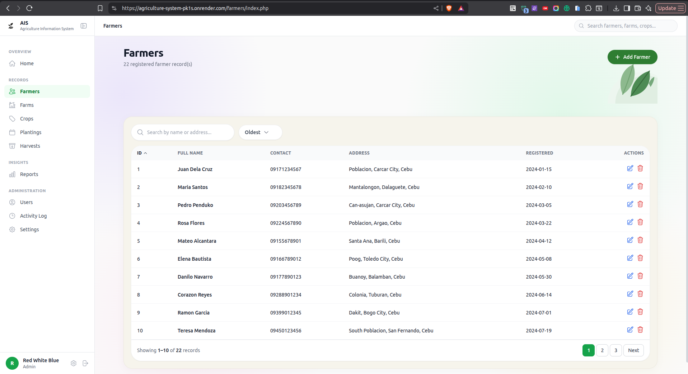

#### Figure 8.4: Farm Parcels Management

**Route:** `farms/index.php`  

*Agricultural land parcel records linked to registered owners, detailing area sizes, soil classifications, and water delivery systems.*  

**Key Elements:** Farmer owner selector, parcel name, geographic location, area in hectares, soil type and irrigation badges, edit/delete actions.


#### Figure 8.5: Crop Master Catalog

**Route:** `crops/index.php`  

*Agronomic commodity database establishing standard crops, hybrid varieties, botanical categories, and seasonal growth cycles.*  

**Key Elements:** Crop species name, cultivar/variety label, category dropdown, maturity cycle in days, optimal season badge, edit/delete actions.

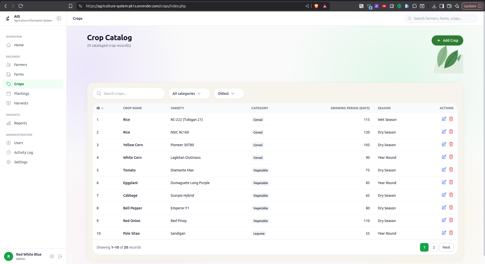

#### Figure 8.6: Planting Cycles Module

**Route:** `plantings/index.php`  

*Operational field transaction module recording planting schedules, land allocation, and seed stock consumption.*  

**Key Elements:** Farm parcel and crop variety selectors, planting date picker, cultivated hectares, seed weight (kg), forecasted harvest date, lifecycle status badge.

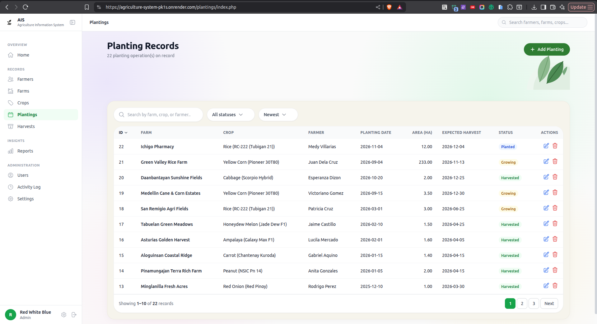

#### Figure 8.7: Harvest Yields & Production Module

**Route:** `harvests/index.php`  

*Production output recording interface capturing commodity weight, commercial valuation, quality grades, and condition remarks.*  

**Key Elements:** Planting cycle reference, harvest date, gross quantity (kg), unit price per kg (PHP), quality grade selector, harvest remark selector, auto status transition.

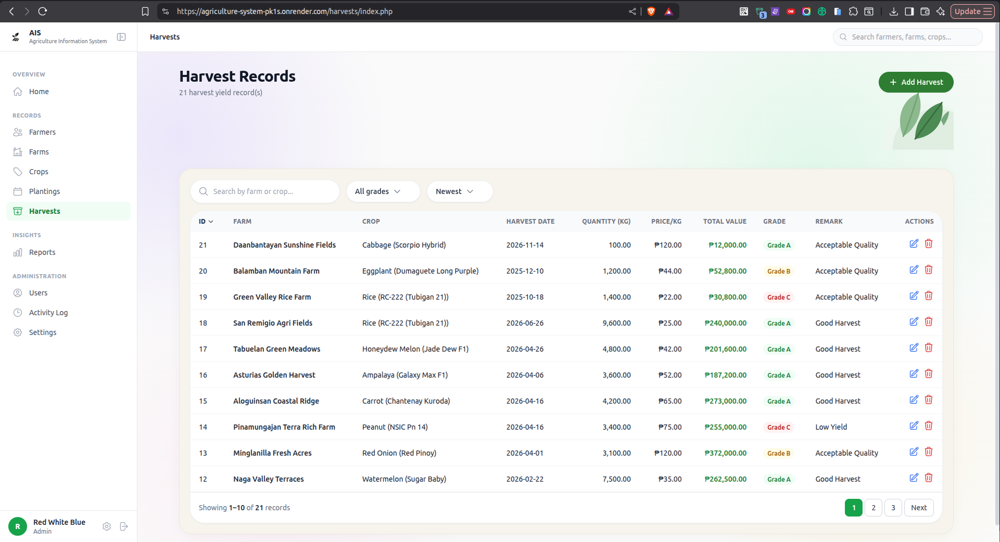

#### Figure 8.8: Operational Reports Overview

**Route:** `reports/index.php`  

*Central reporting hub providing structured access to production, agronomic, and financial reporting modules.*  

**Key Elements:** Report navigation cards, summary descriptions, one-click report launching, data export indicators.


#### Figure 8.9: Report — Farmers & Land Ownership

**Route:** `reports/farmers_farms.php`  

*Consolidated ownership report mapping registered farmers to total operational acreage and farm parcel distribution.*  

**Key Elements:** Farmer search filter, parcel count aggregation, cumulative hectare totals, print report button, Export CSV action.

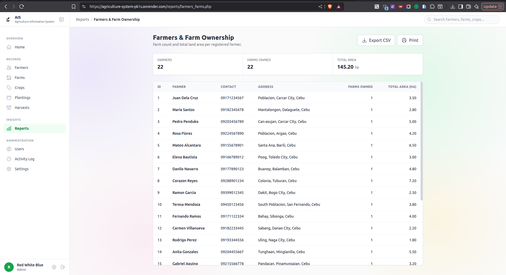

#### Figure 8.10: Report — Crop Production per Farm

**Route:** `reports/crop_production.php`  

*Parcel-specific agronomic production report detailing commodity varieties, land usage, and yield quantities.*  

**Key Elements:** Farm parcel dropdown filter, commodity breakdown, cultivated land area totals, gross yield volume (kg), CSV export.

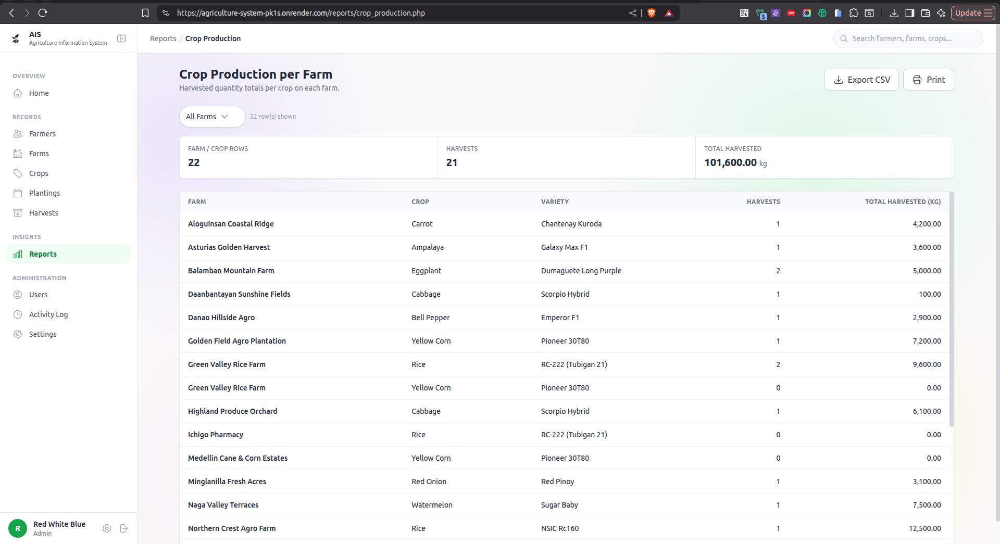

#### Figure 8.11: Report — Planting Cycle Status Breakdown

**Route:** `reports/planting_status.php`  

*Lifecycle monitoring report tracking active and completed planting batches across Planted, Growing, and Harvested phases.*  

**Key Elements:** Lifecycle status filter dropdown, chronological schedule timeline, active crop count, CSV data export.

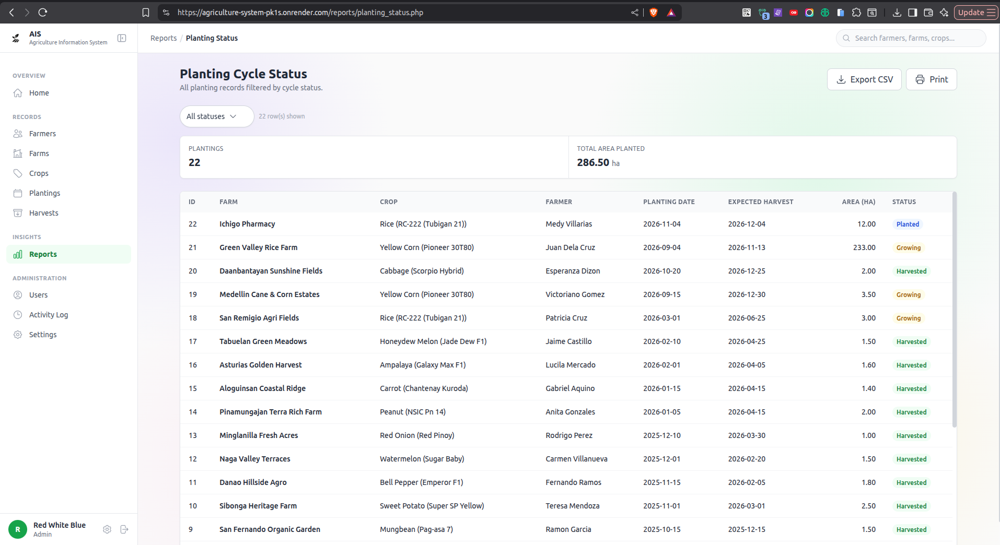

#### Figure 8.12: Report — Harvest Yield & Revenue Analytics

**Route:** `reports/harvest_revenue.php`  

*Comprehensive commercial analytics report detailing physical crop volume harvested and gross financial revenue realized.*  

**Key Elements:** Start and end date range pickers, total kilograms harvested, gross revenue sum in PHP, quality grade distribution, Export CSV.


#### Figure 8.13: Report — Farmer Profitability Analysis

**Route:** `reports/farmer_profit.php`  

*Financial performance breakdown evaluating commodity sales value and economic returns generated per registered producer.*  

**Key Elements:** Producer breakdown, volume produced, average selling price realization, gross revenue rankings, CSV export.


#### Figure 8.14: Report — Seasonal Agro-Climatic Performance

**Route:** `reports/seasonal_performance.php`  

*Comparative agronomic assessment measuring crop performance across Dry Season, Wet Season, and Year-Round cycles.*  

**Key Elements:** Seasonal grouping, yield comparison, rainfall adaptability assessment, visual performance breakdown, CSV export.

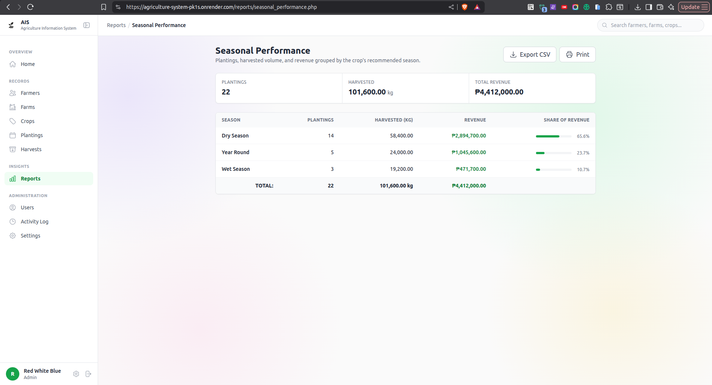

#### Figure 8.15: Report — Yield per Crop Variety

**Route:** `reports/yield_per_crop.php`  

*Agronomic cultivar productivity report analyzing kilograms produced per hectare across distinct hybrid crop strains.*  

**Key Elements:** Cultivar name, category classification, total harvested yield (kg), productivity per hectare metric, CSV export.

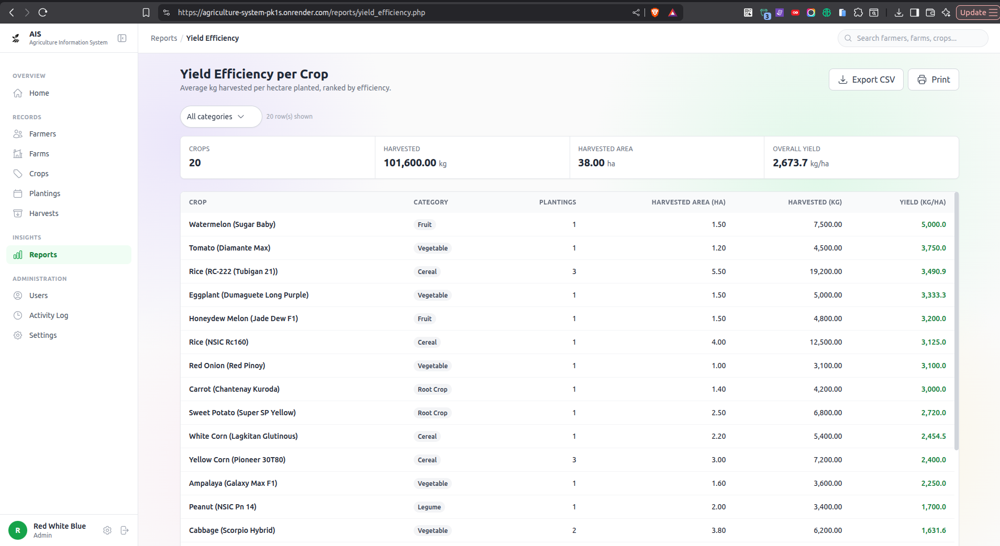

#### Figure 8.16: User Account Management Console

**Route:** `users/index.php`  

*Administrative control interface for managing system operator accounts and configuring role authorizations.*  

**Key Elements:** User directory, role badge (Administrator / Staff), account creation modal, password reset action, soft-deactivation toggle.

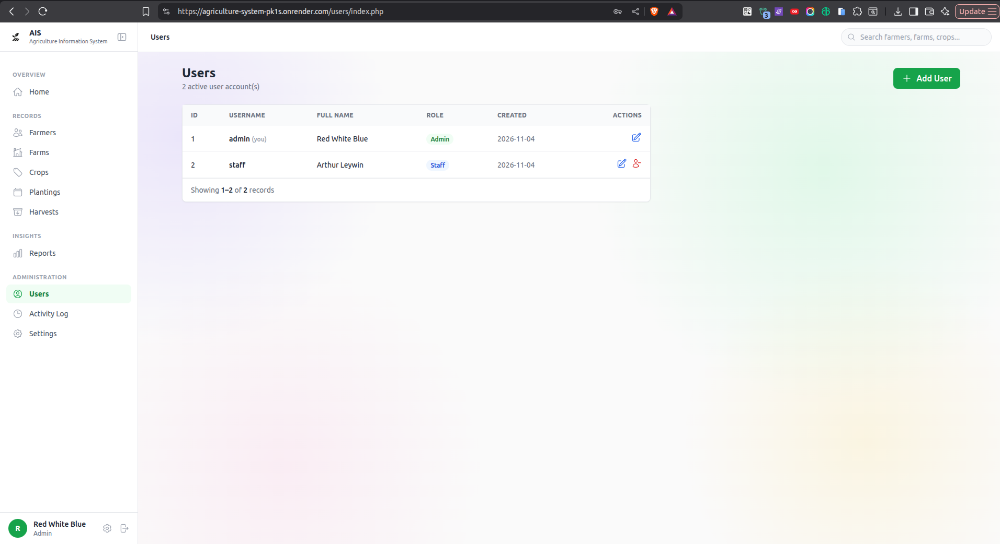

#### Figure 8.17: Audit Activity Log

**Route:** `users/activity.php`  

*Immutable chronological transaction audit trail recording every insert, update, and soft-delete operation across the system.*  

**Key Elements:** Operator identity stamp, action classification badge (Create / Update / Delete), target entity name, record ID, modification details, timestamp.


#### Figure 8.18: Controlled Lookup Settings Manager

**Route:** `settings/index.php`  

*Administrative manager for maintaining reference tables governing controlled dropdown options without modifying source code.*  

**Key Elements:** Tabbed navigation (Soil Types, Irrigation Methods, Categories, Seasons, Statuses, Grades, Remarks), inline add/edit modal, soft-delete toggle.

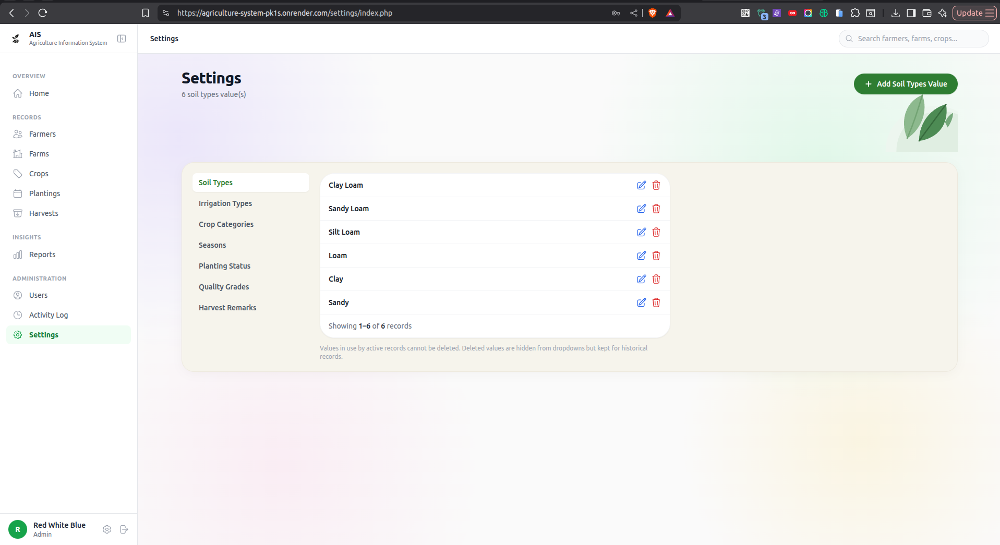

#### Figure 8.19: Operator Profile & Session Management

**Route:** `profile/index.php`  

*Personal operator account portal displaying active role privileges and supporting self-service credential updates.*  

**Key Elements:** Full name, username display, assigned authorization tier, password update form, active session details.


## 9. System Testing Results & Quality Assurance Matrix

All core modules, authentication gates, validation constraints, and reporting endpoints underwent rigorous manual and automated testing against the live Supabase database.

| # | Module | Test Scenario / Scope | Test Input / Action Performed | Expected System Behavior | Actual Verified Outcome | Status |
| --- | --- | --- | --- | --- | --- | --- |
| 1 | Auth | Admin Authentication | Submit valid admin credentials (admin / admin123) | Redirect to executive dashboard; store session tokens. | Redirected to dashboard; session created with admin role. | PASS |
| 2 | Auth | Invalid Password Handling | Submit valid username with incorrect password | Authentication denied; error banner displayed; no session. | Access denied; 'Invalid credentials' alert shown. | PASS |
| 3 | Auth | Protected Route Guarding | Request /farmers/index.php while session unauthenticated | Redirect immediately to /auth/login.php with redirect query. | Redirected to login page; access blocked. | PASS |
| 4 | Farmers | Create New Farmer Profile | Fill all required fields: name, contact, address | Profile saved to Supabase DB; success banner displayed. | Farmer record persisted; visible in directory; audit logged. | PASS |
| 5 | Farmers | Empty Field Validation | Submit create form with missing contact number | Submission blocked; client & server validation error shown. | Form rejected; 'Contact number is required' error shown. | PASS |
| 6 | Farms | Negative Area Validation | Attempt to input area_hectares = -3.50 | Blocked by HTML5 validation and DB CHECK (area > 0). | Rejected with 'Area must be greater than zero' error. | PASS |
| 7 | Plantings | Chronological Date Check | Set expected harvest date before planting date | Submission blocked by JS validation and DB constraint. | Blocked by chk_harvest_after_planting; error banner displayed. | PASS |
| 8 | Harvests | Automatic Status Transition | Record a new harvest yield for an active planting | Harvest saved; planting status automatically flips to 'Harvested'. | Harvest inserted; linked planting status changed to ID 3 (Harvested). | PASS |
| 9 | Dropdowns | Lookup Table Foreign Keys | Select 'Clay Loam' and 'Irrigated' on Farm Form | UI shows text labels; form submits numeric IDs 1 and 1. | Database stores integer foreign keys; joined queries display text. | PASS |
| 10 | Search | Multi-Column Filter Query | Type 'Carcar' into farmers search input bar | Table dynamically filters to records matching 'Carcar'. | Only Carcar City farmers displayed; row counter updated. | PASS |
| 11 | Sorting | Column Ordering | Click 'Area (ha)' table header in farms view | Rows reorder ascending; second click reorders descending. | Table sorts correctly; sorting arrow indicator toggles. | PASS |
| 12 | Integrity | Referential Deletion Protection | Attempt to delete a farmer who has active farms | Deletion blocked or handled via foreign key rule. | Clean user warning displayed; cascade corruption prevented. | PASS |
| 13 | Safety | Delete Confirmation Modal | Click delete action button on any record row | Confirmation dialog opens; deletion requires explicit confirm. | Modal displayed; 'Cancel' aborts; 'Confirm' soft-deletes. | PASS |
| 14 | Reports | Live SQL Data Aggregation | Open 4 reports and verify against raw database queries | Summary metric numbers match manual SQL aggregation. | Live figures match PostgreSQL database queries with 100% accuracy. | PASS |
| 15 | Reports | Date Interval Filtering | Select 30-day date interval on Harvest & Revenue report | Table filters strictly to harvests within date range. | Report narrows to date range; revenue recalculated dynamically. | PASS |
| 16 | Reports | CSV File Data Export | Click 'Export CSV' button on active report view | Browser downloads RFC 4180 formatted CSV file. | Proper CSV file downloaded with exact headers and matching data. | PASS |
| 17 | RBAC | Staff Role Boundary Guard | Log in as staff and attempt to access /users/ or /settings/ | Access denied; redirected to dashboard with warning. | Redirected to dashboard; flash warning: 'Admin required'. | PASS |
| 18 | RBAC | Admin Role Privilege Access | Log in as admin and access /users/ and /settings/ | Full access granted to user accounts and lookup settings. | Admin console loaded with complete CRUD management tools. | PASS |
| 19 | Dashboard | Real-Time Metric Sync | Insert new farmer and verify dashboard counter | Dashboard summary card increments immediately by +1. | Summary counter updated dynamically reflecting database state. | PASS |
| 20 | Responsive | Mobile Navigation Bar | View application on mobile screen width (<768px) | Sidebar hidden; bottom navigation bar enabled and functional. | Layout adapts cleanly; bottom navigation provides quick tab switching. | PASS |
| 21 | Audit | Audit Trail Logging | Perform create/update/delete operations across modules | activity_log table records user ID, action, and timestamp. | Activity log accurately records all transactions chronologically. | PASS |


## 10. User Guide / Operating Instructions

### 10.1 System Authentication & Access
1. Open the web browser and navigate to the AIS URL; unauthenticated requests redirect automatically to `auth/login.php`.
2. Enter valid credentials (e.g., Administrator `admin` / `admin123` or Field Staff `staff` / `staff123`).
3. Click **Sign In**. Upon cryptographic verification of the password hash, the session is created and the user is redirected to the executive dashboard.
4. To terminate an active session securely, click the account icon in the navigation bar and select **Logout** (`auth/logout.php`).

### 10.2 Navigating the Executive Dashboard
- **Live Summary Cards:** Displays real-time operational counts: Total Farmers, Registered Farms, Crop Varieties, Active Plantings, and Harvest Records.
- **Dynamic Date Filter:** Use the date range selector to analyze production and revenue metrics over custom time intervals.
- **Actionable Alerts:** Highlights plantings approaching their expected harvest dates and shows a real-time status distribution chart.
- **Recent Activity Feed:** Displays the most recent five agricultural operations executed across the cooperative.

### 10.3 Core Module Operations (Farmers, Farms, Crops, Plantings, Harvests)
- **Viewing Records:** Click any module from the navigation sidebar (desktop) or bottom navigation bar (mobile) to access its tabular directory.
- **Searching & Filtering:** Enter keywords into the search bar to query names, varieties, or locations in real time. Use dropdown filters to narrow records by category, soil type, or status.
- **Adding Records:** Use the embedded registration card or click **Add Record**. All lookup-driven fields (such as Soil Type, Irrigation Method, Category, Season, Grade, and Remark) are presented as dropdowns backed by database lookup tables.
- **Editing Records:** Click the **Edit (Pencil)** icon on any row to open the edit dialog, pre-populated with current database values.
- **Safe Deletion:** Click the **Delete (Trash)** icon. A confirmation dialog will prompt for explicit confirmation before marking the record as soft-deleted (`is_deleted = TRUE`).

### 10.4 Generating Operational Reports & CSV Export
1. Navigate to **Reports** in the navigation bar.
2. Select one of four dedicated reports: **Farmers & Farms**, **Crop Production**, **Planting Status**, or **Harvest & Revenue**.
3. Apply report-specific filters (e.g., select an individual farm parcel or specify a calendar date range).
4. Review the dynamically calculated aggregations (total area planted, total kilograms harvested, gross revenue).
5. Click **Export CSV** to download a structured, RFC 4180-compliant spreadsheet file for external archival or presentation.

### 10.5 Administrative Controls (Administrator Only)
- **User Management (`users/index.php`):** Create new staff or administrator accounts, update personal details, change passwords, and deactivate operator access.
- **Lookup Settings (`settings/index.php`):** Manage controlled reference data for soil types, irrigation methods, crop categories, seasons, planting statuses, quality grades, and harvest remarks without writing database queries.
- **Audit Activity Trail (`users/activity.php`):** Inspect an immutable chronological record of every insert, update, and soft-delete operation performed across the system.

## 11. Deployment & Technical Architecture

### 11.1 Cloud Database Hosting (Supabase PostgreSQL)
- **Platform:** Hosted on Supabase Cloud Infrastructure (AWS AP-Southeast-1).
- **Connection Protocol:** Standard PostgreSQL connection via PHP Data Objects (`PDO_PGSQL`) with SSL encryption (`sslmode=require`).
- **Environment Variables:** All database credentials (`DB_HOST`, `DB_PORT`, `DB_NAME`, `DB_USER`, `DB_PASS`) are loaded securely via `.env` / environment configurations.

### 11.2 Application Security & Best Practices
- **SQL Injection Prevention:** 100% of database interactions are executed via PDO prepared statements with strict parameter binding.
- **Password Hashing:** Passwords are cryptographically secured using PHP's native `password_hash()` utilizing the industry-standard bcrypt algorithm.
- **Cross-Site Scripting (XSS) Mitigation:** All dynamic output rendered in HTML templates is sanitized using `htmlspecialchars(..., ENT_QUOTES, 'UTF-8')`.
- **Cross-Site Request Forgery (CSRF):** Form submissions utilize cryptographically random session-bound CSRF tokens validated upon submission.
